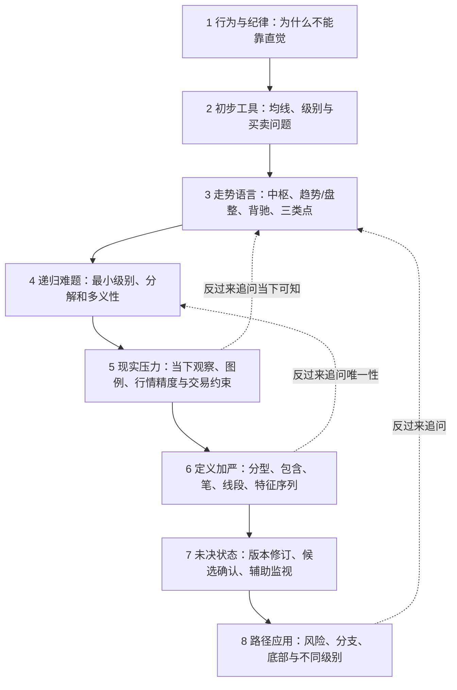
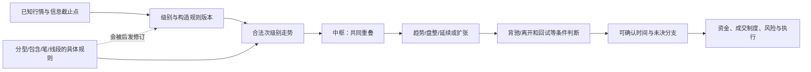

# 《缠论》108课的行文脉络：作者如何提出问题，后文又怎样补前文的缺口

> **阅读方法**：这里是AI对既有108课研究材料的**逻辑重建**，不声称作者从第一课起就写好一套严格章节大纲。原书具有连载、问答、后附文章和编辑注释混排的特点；“写作先后顺序”“概念依赖顺序”“后期修订发生顺序”不是同一条线。本页优先回答**为什么会从上一组问题走到下一组问题**，而不是简单把目录缩成八行。每个主题提供原课回链；原PDF图像尚有待审位置。

## 一、全书最主要的悬念

**从“我不该凭感觉买股票”到“我能不能在当下合法确认一种市场结构”，再到“确认后如何操作而不把事后解释冒充当时的能力”**，是这套连载可重建的一条问题链。

这条链存在两种方向：作者的推进线负责**提出结构语言**，后续章节不断暴露的难题推动**定义加严、规则修订、时间约束和现实执行限制**。因此，“前面的说法很有力、后面却不断补定义”不是读者理解力不足；这确实是连载文本与结构体系成长的交叉结果。

### 脉络总图（AI重建，不是原作者公布的目录）

**真正的中心不是某个指标，而是三次跨越**：从人的决策叙述走向可定义的结构；从结构走向**当下可确认的结构**；从确认走向**可执行而不保证盈利的行动**。

## 二、八个主题块：每块回答什么、为何会引出下一块

### 第一段｜第1—10课：先反对随意交易，再谈是否能有一套方法

**原文表层**：赢家/输家、理性、主观喜好、资金管理、不同筛选信息。第9课的三重筛选概率叙述是这一阶段的典型技术萌芽。[第9课原证据](../../../knowledge/evidence/chanlun_lesson009.json)。

**AI看到的潜在线索**：作者先试图移除“凭喜好行动”的障碍。但单靠批评冲动，不会自然产生可执行的买卖规则；因而下一步需要从市场内部寻找**可共同讨论的观察对象**。

**本段缺的桥**：作者的盈利/理性叙述含强价值判断；“有纪律”不自动推出“能获利”。第9课多个失败率相乘的例子也必须明确独立条件及联合事件，而不是只看算式好看。

### 第二段｜第11—16课：从人的纪律转到市场上的图和级别

**原文表层**：均线、早期买卖点、趋势与背驰的初步提法，跨周期的联动。[第14课](../../../analyses/books/chanlun/chapters/lesson_014.md) · [第15课](../../../analyses/books/chanlun/chapters/lesson_015.md)。

**引出后文的问题**：画出一个看似正确的低点，为什么还需要讲“级别”？因为周线、日线和更小尺度观察的是不同的**结构状态和确认时间**。一旦有级别，下一步就不得不问：到底什么对象能让你判定同一级别的趋势或盘整？

### 第三段｜第17—30课：中枢成为概念中心，背驰和买卖点围绕它构成条件体系

**原文表层**：第17课的走势完成性与中枢、第20课的中枢边界和第三类点、第21课的完备性、第24—25课的MACD辅助、第27课区间套。[第17课](../../../knowledge/evidence/chanlun_lesson017.json) · [第20课](../../../knowledge/evidence/chanlun_lesson020.json) · [第24课](../../../knowledge/evidence/chanlun_lesson024.json)。

**为什么是主干**：市场概念开始从“看起来要涨”转为“哪些完成的次级别走势重叠、离开、回试、力度对比”。这使理论有了被提问的机会：**如果图上几段还没完成，判断到底从哪一刻起算合法？**

**不能偷换的三件事**：结构分类可以完备，不代表结构解析唯一；结构确认成立，不代表当时能够按极值成交；某次回试符合第三类点的几何条件，不代表成本后绝对盈利。

### 第四段｜第31—45课：递归分解的循环难题与真实资金约束同时浮现

**原文表层**：第31课资金管理、第33课多义性、第35课从最低层出发的分解定理和结合律、第40课多级别资金安排。[第31课](../../../knowledge/evidence/chanlun_lesson031.json) · [第33课](../../../analyses/books/chanlun/chapters/lesson_033.md) · [第35课](../../../knowledge/evidence/chanlun_lesson035.json) · [第40课](../../../analyses/books/chanlun/chapters/lesson_040.md)。

**为什么这段重要**：第17课已经需要“次级别走势”来定义中枢；可次级别走势又可能借中枢来定义，容易绕成循环。作者试图以基例及递归解决这点，同时讨论现实操作级别。**这不是重复前面的中枢，而是逼问“这套语言的语法怎么从零开始”。**

**AI关键判断**：`(A+B)+C=A+(B+C)`只管序列连接的括号，不独立保证对每条行情有且只有一种合法解析。理论允许多义解释时，应该保留候选而不是暗中补一个“最喜欢的分段”。资金也不是多尺度之间能重复支配的虚拟对象。

### 第五段｜第46—61课：具体图例、当下判断与精度问题让抽象结构接受压力

**原文表层**：日内类别、现实政策扰动、图上细微价差、实时与事后比较，第59课讨论报价精度影响线段划分，第61课进一步讲区间套。[第59课](../../../knowledge/evidence/chanlun_lesson059.json) · [第61课](../../../analyses/books/chanlun/chapters/lesson_061.md)。

**为何向后过渡**：如果一个行情例子在不同软件精度下被分出不同结构，或者图片所示极值只在未来确认，就需要把“概念是对的”升级成“**输入、归并次序、时点和版本都可检查**”。

**内容风险**：原图精确价格目前有未核页，不能靠AI重画一个“好看的历史例子”掩盖源数据缺口。

### 第六段｜第62—81课：从宏观语言下沉到具体“分型、笔、线段”的判定语法

**原文表层**：第62课分型/笔/线段与包含，第65课非传递性，第67课缺口与特征序列，第71课严格成员，第77、81课不同版本的笔。[第62课](../../../knowledge/evidence/chanlun_lesson062.json) · [第65课](../../../knowledge/evidence/chanlun_lesson065.json) · [第67课](../../../knowledge/evidence/chanlun_lesson067.json) · [第71课](../../../knowledge/evidence/chanlun_lesson071.json)。

**这是前文的“补地基”**：前面描述中枢、背驰需要靠谱的结构划分；现在作者详细讨论最低一层的构造。可以把这段看作从自然语言转向“更像编译器的语法规范”，但是**存在后发版本及编者争议**。

**版本不能抹平**：第62课卷三p.295后的“新笔”发表时间未定；第77课卷四p.158—160与第81课卷四p.241独立署时的后发规则不能伪装为同一次原始定义。见[规则版本历史](../../../catalog/chanlun_rule_history_v1.json)。

### 第七段｜第82—95课：在尚未确认的过程中，什么能作为监视器而不冒充结论？

**原文表层**：分型后续成笔条件、噪声与自相似、BOLL收口、Zn中轴预警、资金风险。[第90课](../../../knowledge/evidence/chanlun_lesson090.json) · [第92课](../../../analyses/books/chanlun/chapters/lesson_092.md)。

**为什么接着上段**：当底层分型/笔的成立规则更严格，读者会发现“当下”有大量**候选和等待**。辅助指标能帮助观察，却不能替代正式结构成立所需证据。

**重要分界**：`WARNING`是预警、`CANDIDATE`是候选、`CONFIRMED`才是满足相应已声明条件的确认；它们不是换个名字的一回事。

### 第八段｜第96—108课：未决分支、重新组织和“底部”的两个定义合同

**原文表层**：第99课后验重组，第100课作者与编者对路径存在异议，第102课独立讨论走势完美及唯一性，第106课板块相对强弱，第108课从分型与走势结构两条路径谈底部。[第99课](../../../knowledge/evidence/chanlun_lesson099.json) · [第100课](../../../knowledge/evidence/chanlun_lesson100.json) · [第102课](../../../analyses/books/chanlun/chapters/lesson_102.md) · [第108课](../../../knowledge/evidence/chanlun_lesson108.json)。

**AI读到的收束**：最后不是“终于找到了一个万能指标”，反而把**结构候选、版本差异、操作限制与未来路径**暴露得更清楚。第108课两种底部合同尤其说明：一个自然词可以隐藏多个不等价的完成定义。

**未决**：原书编者异议与作者强断言无法只靠解释一方词语解决；一项“好看的结构分类”与其真实市场收益仍是两个不同证据问题。

## 三、读书顺序可以与发表顺序不同：先建立概念依赖

下面是**理解概念所需的先后**（不意味着历史上作者恰按此顺序提出，也不是无争议的唯一依赖图）。

**关键逆序阅读**：原书第17—21课讨论中枢等核心结构时，第62—81课的部分底层判定规则还在后文。第一次读不懂时，**可回头看第62、65、67、71、77、81课补地基，再回到第17、20、24、27、35课**。这是一条读者学习路径，不是历史作者的原始授课顺序。

## 四、三条容易被混在一起的时间线

| 时间线 | 记录什么 | 为什么重要 |
|---|---|---|
| **文章线** | 各课发文日期、后来插入的文章与编者注释 | 第53课卷三p.162中段有独立署时2009-01-05内容，不能随第53课2007年原文合并 |
| **定义线** | 旧笔、后发新笔、线段成员与破坏条件的不同规则版本 | 第77课与第81课后发表材料不该“回灌”到原规则当年的判断 |
| **市场线** | 价格极值发生、可观测、结构候选、最终可确认、可成交 | 第108课2008-08-29的讨论不能借用之后月线结果 |

参见 [第53课证据](../../../knowledge/evidence/chanlun_lesson053.json)、[第81课证据](../../../knowledge/evidence/chanlun_lesson081.json)、[第108课证据](../../../knowledge/evidence/chanlun_lesson108.json)。**文章被后人收入一套汇编**不等于其中全部评论在历史同一时点已被作者知道。

## 五、从“作者如何写”到“我如何读”：五条问题链

| 读到的疑问 | 用哪些课连起来 | AI要追问的下一层 |
|---|---|---|
| 为什么不要凭感觉交易？ | 1—10 → 11—16 | 当下凭什么说自己的规则比直觉更合理？ |
| 什么是走势的基本对象？ | 17 → 20 → 35 → 62—81 | 中枢需要次级别走势，而底层走势怎么从零构造？ |
| 为什么背驰/买点不是一个指标？ | 15 → 17 → 20 → 24 → 27 | 比较哪段、什么级别、何时完成、何时可知？ |
| 为什么最终画图不能替代当下交易？ | 32—35 → 59—61 → 67/71 → 99/102 | 来源版本和在线待定结构如何留历史记录？ |
| 如何谈底部而不许诺收益？ | 20/21 → 90/92 → 100 → 108 | 预警、正式结构、风险账户是不同合同 |

## 六、AI独立读后判断

这套文本最值得保留的不是某一个“绝对可预测的秘密”，而是它试图让研究者对**走势级别、结构依赖、后续分支、确认时刻**拥有共同语言。最值得继续审视的则是：**从“存在合理分类”迈向“唯一可计算”、从“当下确认”迈向“可成交且获利”**的桥梁并非自然成立。

同时也要承认：这是一份**基于现有108课首轮研究所作的AI结构化重建**；不是重新完整校订五卷的逐图学术注本。所有尚未复核的视觉和编辑问题仍见[来源覆盖缺口](../00_REVIEW/DETAIL_COVERAGE_GAPS.md)。

继续阅读：[12组核心命题白话解释](01_核心定理与规则白话解读.md) · [图示讲解](03_关键概念图示讲解.md) · [争议与启发](04_AI视角下的争议与启发.md)。
