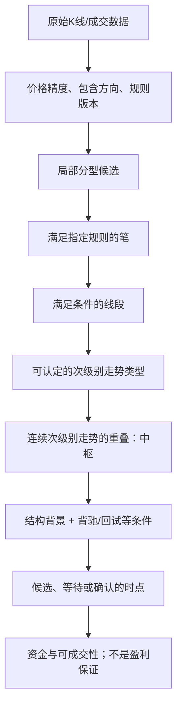
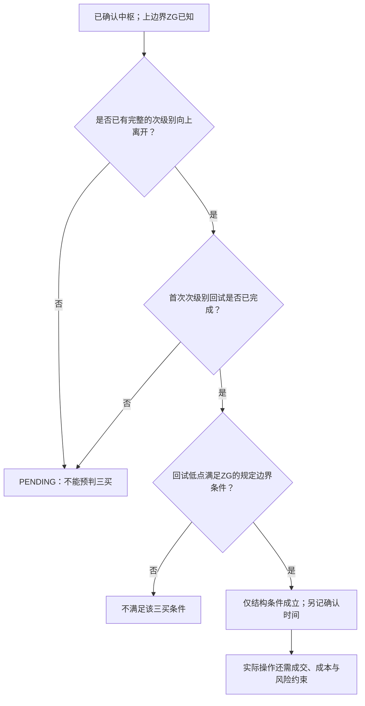
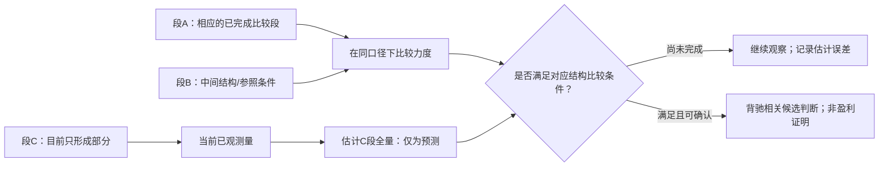
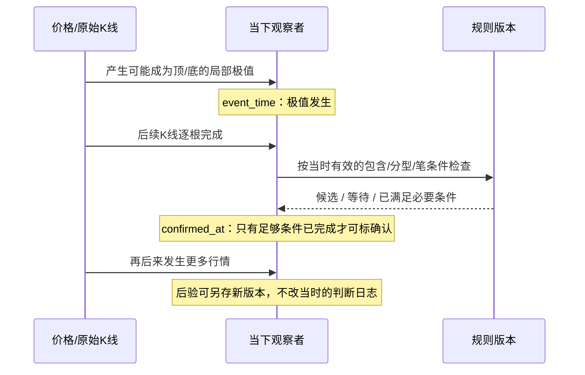
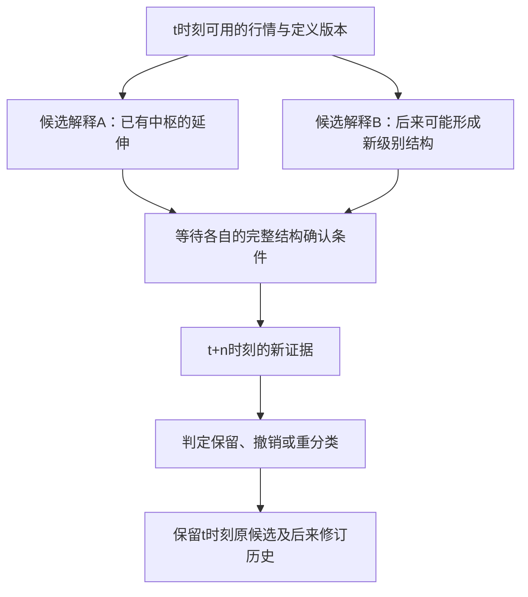
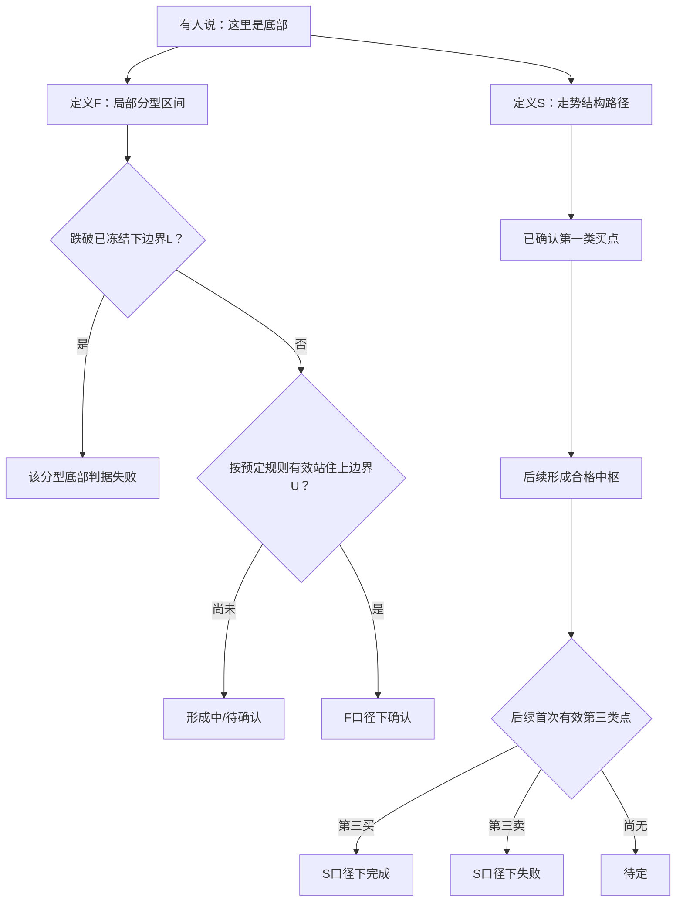

# 《缠论》关键概念图示：用状态、区间和分叉代替玄学式画线

> **八张AI自制的教学示意图**，可以直接在GitHub Markdown中以Mermaid渲染；与历史行情图不同，这里只画**条件关系**。它们不是原作者插图，也不宣称给出了完整笔、线段、中枢解析程序；需要保留来源争议和规则版本。建议先读[核心命题白话解释](01_核心定理与规则白话解读.md)，再逐张对照规范章节研究。

## 图1｜概念不是“一根K线直接生成买点”的直线



**怎么读**：每箭头都需要不同的必要条件，“上层有名字”不能替代“下层按某版本合法成立”。尤其**第17课的中枢解释与第62—81课的笔/线段条件来自连载不同时段**，图为读者学习顺序而不是作者同时发布的完备算法。

来源：[第17课](../../../knowledge/evidence/chanlun_lesson017.json) · [第62课](../../../knowledge/evidence/chanlun_lesson062.json) · [第81课](../../../knowledge/evidence/chanlun_lesson081.json)。

## 图2｜三个合法次级别区间如何得到重叠部分？

**注意：先假设三段已完成、同级别且相连；仅凭以下区间无法证明它们真有“合法次级别走势”身份。**

```text
AI教学假设：
段A覆盖   9 ├──────────────┤ 16
段B覆盖      11 ├─────────────────┤ 18
段C覆盖         12 ├───────┤ 15
共同交集        12 ├───────┤ 15
                     ↑      ↑
                   下边界   上边界
```

对应区间运算：`max(9,11,12)=12`，`min(16,18,15)=15`，因此交集是`[12,15]`。

**反例提醒**：如果三段根本不是连续的合法次级别走势，或第三段还未完成，即使机械算出区间交集，也**不能直接盖“正式中枢”章**。临界仅有一个端点的情况还需单列等值、价格精度与规则口径。

来源：[第17课卷一p.197](../../../knowledge/evidence/chanlun_lesson017.json) · [第20课卷一p.245—247](../../../knowledge/evidence/chanlun_lesson020.json)。

## 图3｜第三类买点不是“突破就买”



**一眼辨错**：一根K线上冲、不完整回试、忘记“第一次”、没有合法次级别走势，都不足以认定第三类买点。原文讨论过**第三买点后仍可能转入更高级别盘整**，因此图示**不把成立后的分支统一画成上涨**。

来源：[第20课卷一p.247](../../../knowledge/evidence/chanlun_lesson020.json) · [第21课卷一p.253](../../../knowledge/evidence/chanlun_lesson021.json)。

## 图4｜背驰比较：观测量与尚未发生的量不能混为一谈



**白话**：当你只跑了半程，不能把“现在已经跑了五公里”直接说成“整场只跑五公里”。第24课里以局部MACD柱面积乘二估整体的做法是一种**估计**；未来的柱体尚未发生。

来源：[第24课卷二p.3—4](../../../knowledge/evidence/chanlun_lesson024.json)。**图只解释信息边界，不把MACD面积当作背驰全部定义**。

## 图5｜分型的三个时间与笔规则版本



**最常见错觉**：今天看到了一个大顶，便把其发生时间当作“那天人人已经知道这是正式顶”。**发生时刻**与**达到确认条件的时刻**并不相同；第67课线段破坏更可能需要后续反向特征分型。

来源：[第62课](../../../knowledge/evidence/chanlun_lesson062.json) · [第67课](../../../knowledge/evidence/chanlun_lesson067.json) · [第71课](../../../knowledge/evidence/chanlun_lesson071.json)。

## 图6｜结合律不代表唯一分段

```text
原始时序：  A — B — C

连接顺序不变：
        (A+B)+C       A+(B+C)
            ╲           ╱
             同一串接顺序

但“将连续数据标为哪几个走势单元”的问题可能还有：
        [A+B] [C]     [A] [B+C]     [A+B+C]
                     ↑
             哪一种合法？需要额外的文法、级别和完成条件
```

**AI观点**：字符串或序列连接满足结合律是一个代数事实；市场形态的**语义分解**能否唯一，则需要另一个证明。更不能由“能以某种方式解读图形”推出“当时确定知道这就是唯一解”。

来源：[第35课卷二p.291—292](../../../knowledge/evidence/chanlun_lesson035.json) · [第99课卷五p.202](../../../knowledge/evidence/chanlun_lesson099.json) · [第102课研究](../../../analyses/books/chanlun/chapters/lesson_102.md)。

## 图7｜多义性：先保存分支，再等证据，不要篡改历史



**补一条容易误解的细节**：第65课所谓包含关系的“非传递”属于原文的**按次序、方向和相邻处理**语境；不要把它误写成普通集合包含`A⊇B且B⊇C却A⊉C`。普通集合包含当然满足传递律。原文规则的归并**操作语义**和抽象区间集的数学关系不能偷换。

来源：[第33课](../../../analyses/books/chanlun/chapters/lesson_033.md) · [第65课](../../../knowledge/evidence/chanlun_lesson065.json) · [第99课](../../../knowledge/evidence/chanlun_lesson099.json)。

## 图8｜第108课两种“底部”不是相同的状态机



**怎么用**：你必须先说明在用`F`还是`S`口径，否则两个人说“底部确认”可能压根不在讨论同一件事。上图的`F/S`名称是**AI解释标签**，不是书中已经严格证明的两套算法；特别是“有效站住”仍需明确定义。

来源：[第108课卷五p.395—399](../../../knowledge/evidence/chanlun_lesson108.json)，原图p.396—398仍有精确数字未核缺口。

---

## 统一图示约定与边界

- **实线流程**：只是教学上的条件依赖，不表示收益有因果保证。
- **候选/等待/确认**：只有满足明确规则时才升级；箭头无法代替合法证明。
- **图内示例数字**：除注明来源的原书讨论外，均是AI构造的说明数字。
- **原书署时与后编意见**：不要因为汇编中连在一起，就当作同一位作者、同一时刻提出。
- **图表复核状态**：本模块的Mermaid图均为新绘，不能取代[原书五卷](../../../ChineseBooks/缠论)及[尚未核准的源图清单](../00_REVIEW/DETAIL_COVERAGE_GAPS.md)。

后续新书必须至少提供**一张全书论证脉络图＋覆盖核心概念的可读条件图**。确实没有适合图形化的命题时，可以用对照表、时间线或反例树替代，但必须说明为什么；不能用单纯装饰图充数。
