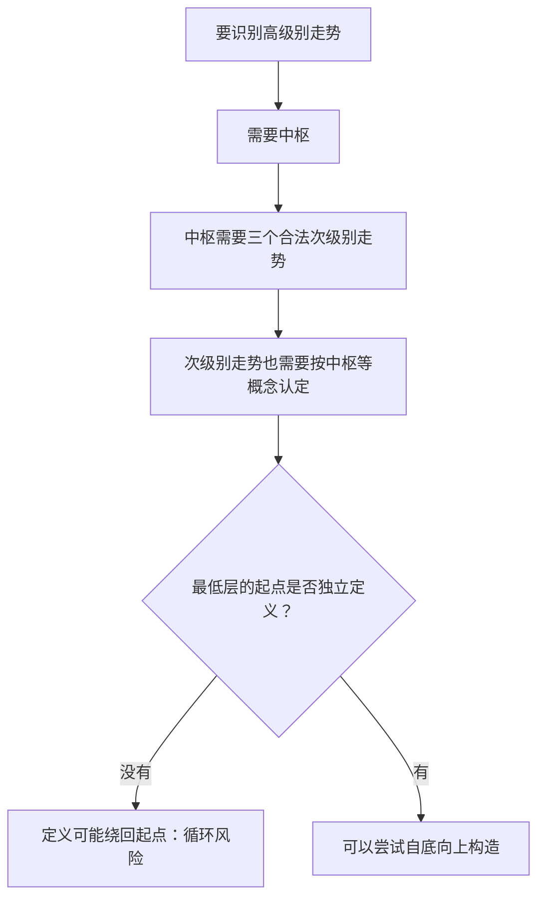
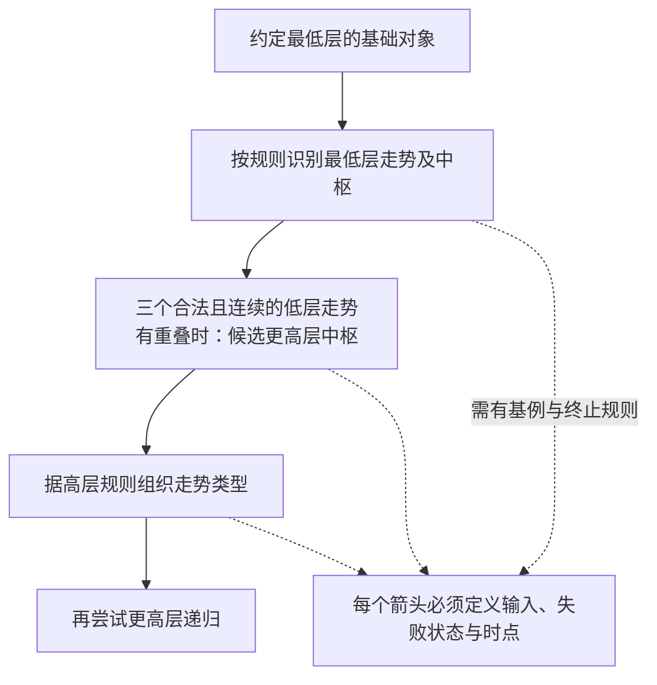
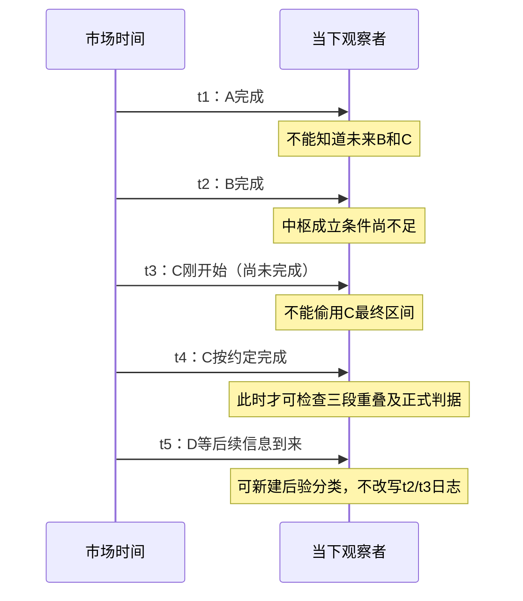
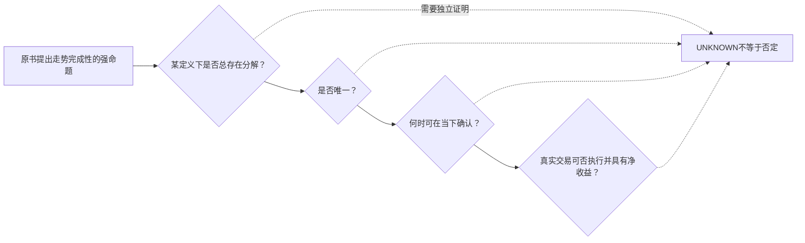

# 专题教程一｜“走势终完美”与走势分解：一层层拆开，哪些地方还没有证明？

> **读完要会回答**：为什么作者要从“走势类型”讲到“最低级别”？所谓“走势终完美”解决了哪个问题，又没有自动解决哪几个问题？图里的分解究竟是**作者断言、定义安排、还是AI教学案例**？本教程基于已有原文证据，**未重新逐页核验原书所有图片**。全部例子为AI教学构造，不对应实际A股行情，也没有市场回测。

## 先用一句大白话说透

想象一条还在延长的绳子。你可以事后把它分成几段，讨论哪里有重叠、哪里转向；作者希望这套“分段语法”能一路从小段组织成大段。**但“最后能画出一种分段”不等于“此刻分段已完成”，更不等于“只有这一种分法”或“能据此获利”。**

原文线索：[第17课卷一PDF p.196—198](../../../knowledge/evidence/chanlun_lesson017.json)、[第33课卷二p.256—257](../../../knowledge/evidence/chanlun_lesson033.json)、[第35课卷二p.291—292](../../../knowledge/evidence/chanlun_lesson035.json)、[第99课卷五p.202—203](../../../knowledge/evidence/chanlun_lesson099.json)、[第102课卷五p.241—242](../../../knowledge/evidence/chanlun_lesson102.json)。

## 第一幕：第17课先给出“高层语法”

【原作者主张｜SOURCE】第17课引入“走势终完美”的结构性命题，并用**三个连续、已完成的次级别走势类型的共同重叠**定义相应中枢。用中枢数目及其关系区别趋势、盘整等类型。

【AI解读｜INTERPRETATION】这一安排有吸引力：同一幅价格图不再只是“高了、低了”，而有了能够讨论的对象。但你一旦问“什么算次级别走势类型”，又会问“它用什么构成”；如果答案还是“中枢”，就面临**递归的起点在哪里**。



这里的“循环风险”是**AI审读提出的形式化问题**，并不等于宣判作者的整个体系为无效；第35课恰恰试图回应它。

## 第二幕：第35课尝试补上“递归地基”

【原作者主张｜SOURCE】既有研究记录：第35课提出从最低级别成交序列出发，用**连续三笔同价成交**约定最低级别的中枢，再逐层构造走势类型、中枢及走势分解；还提出两条“走势分解定理”和连接的结合律。[第35课证据](../../../knowledge/evidence/chanlun_lesson035.json) · [逐课七重研究](../../../analyses/books/chanlun/chapters/lesson_035.md)。

【AI白话】不允许“一个词由句子定义、句子又由这个词定义”无穷追问，所以先把基本单位定死，然后层层组装。相当于计算机语法先规定字符，再规定词、句子、章节。



**别跳过的困难**：如果一段真实成交序列中根本没有连续三笔完全同价，基础约定如何处理？这个问题属于“定义的适用域/完整性”，既有研究对它也提出了独立审计要求。不能因为递归写成箭头，就假设对**每段任意行情**都可得到唯一结果。

## 第三幕：手动推演一个“能理解但不能拿来证明”的小例子

**纯AI构造的抽象序列**：假设另有一个明确的低级别规则，已经分别确认`A`、`B`、`C`是**连续、同一级别、已经完成**的三个走势类型，它们的价格区间如下：

| 虚构单元 | 最低价 | 最高价 | 本例预先规定的状态 |
|---|---:|---:|---|
| A | 10 | 16 | 完成且合法 |
| B | 12 | 18 | 完成且合法 |
| C | 13 | 15 | 完成且合法 |

在这些**人为预设**下，共同区间是 `[max(10,12,13), min(16,18,15)] = [13,15]`。这说明了**已认定低层对象的区间重叠如何形成高层候选**。

**关键的四次检查**：

1. 只有价格区间重叠，但没有证明A/B/C是合法的次级别走势？→ **不能确认中枢**。
2. A、B完成了，C只进行到一半？→ 目前只能说“若未来C合法完成且仍重叠，则可能形成”；**不能把未来完成时刻提前**。
3. C完成了，但三段并非连续或不是同级别？→ 这个简算例不符合原文构造的基本条件。
4. 已有三段重叠，之后的D、E还会继续改变整体分段？→ 可以有后续扩展/重组，但必须保存**当时的候选与后来修订**，不能改写早先信息。



**一句重要的数学限制**：区间交集的计算很确定，不等于**如何获得A/B/C**同样确定。后者恰恰是这套理论的难点。

## 第四幕：两条“分解定理”要怎样正确学习？

第35课确实提出“走势分解定理”；本导读不把本项目对其**概括性释义**冒充为原文逐字定理或严格完整公理化表述。

| 读者应拆开的层次 | 你需要的证据 | 不能由它推出 |
|---|---|---|
| **定义/分类**：给某类走势规定组成规则 | 术语、级别、构造条件 | 所有行情都可分类 |
| **存在性**：给定合法输入至少有一种完整分解 | 对任意合法输入的构造证明 | 分解只有一种 |
| **唯一性**：合法分解集合恰有一个元素 | 确切规则、平局裁决、排除反例的证明 | 能在当时立即看出 |
| **实时可判定性**：在时点t只用当时信息能确认 | 在线输入、确认时钟、未决处理 | 盈利或可成交 |
| **交易效用**：确认后可执行且有预期净收益 | 市场样本、费用与制度、负面结果 | 本次研究已经证明 |

例如第102课把递归分解与自然数进位表示类比。**AI评价**：自然数在确定进位规则下有唯一表示，不会自动替一套仍在修订的走势图形规则证明唯一性；必须逐项构造证明。[第102课研究](../../../analyses/books/chanlun/chapters/lesson_102.md)。

## 第五幕：结合律不是“万能唯一性证明”

【原文线索】第35课使用走势连接的结合律而非交换律，第33、99课讨论多义性和后续重组。

```text
原始按时间排列的序列：A → B → C

(A+B)+C  =  A+(B+C)    ← 只说“拼接顺序”相同
A+B      ≠  B+A        ← 时间顺序不可随意调换

但是否应划分成：[A+B] [C]，还是 [A] [B+C]？
这由“合法走势语法”决定，不由括号恒等式单独决定。
```

**AI独立反问**：如果你只拿到原始价格序列，没有声明分型、包含、线段破坏、级别版本和未完成处理，是否存在多种不同的合法解释？**这需要检验，而不是靠一句结合律跳过**。

第33课（卷二p.256—257）已有关于中枢延伸、高层重组和多义性的原书讨论；第99课（卷五p.202）讨论后来重组。它们不自动证明“任意划法都对”，而提醒我们给每一种解释附上条件。

## 第六幕：把“终完美”还原成四个不同的问题



**AI读后结论**：最值得学的是作者持续尝试把自然语言交易直觉转化为**可以逐层构造的结构对象**；最值得质疑的是不同证明义务之间有没有充分的桥梁。尤其不能把“事后有结构”说成“事前可准确预测”。

### 自检：不用看答案先想三道题

1. 看到三段价格区间交集，你还缺哪个“合法身份”的证据？**答：三段须为连续、同级别、按指定规则完成的走势类型。**
2. 第35课先定最低层，是为了回应什么？**答：较高级别定义互相引用导致的循环起点问题。**
3. 序列连接结合律能证明在线唯一分解吗？**答：不能；语义合法性、冲突裁决、确认时间还需独立论证。**

**继续学习**：[教程二：中枢→背驰→三类点](06_专题教程_中枢背驰与三类点.md) · [教程三：分型→笔→线段](07_专题教程_从分型到线段中枢.md)。未完成的证据核准请见[优先复核清单](../00_REVIEW/DETAIL_COVERAGE_GAPS.md)。所有研究命题保持`NOT_RUN`。
