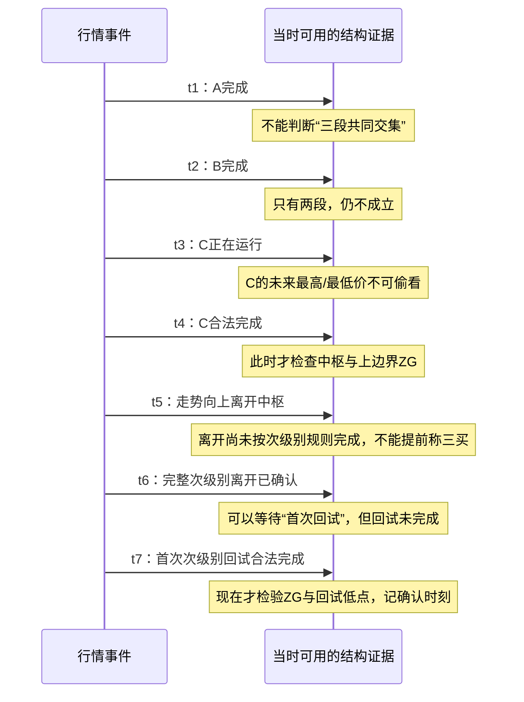
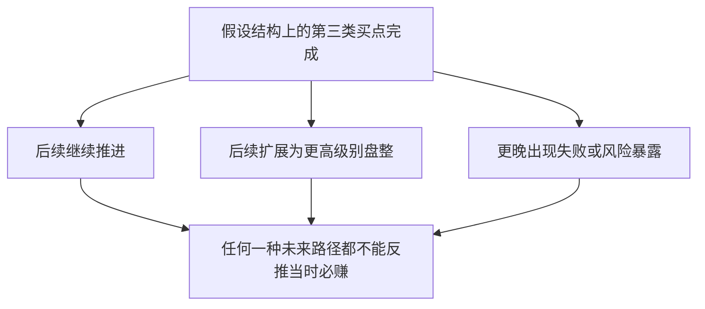
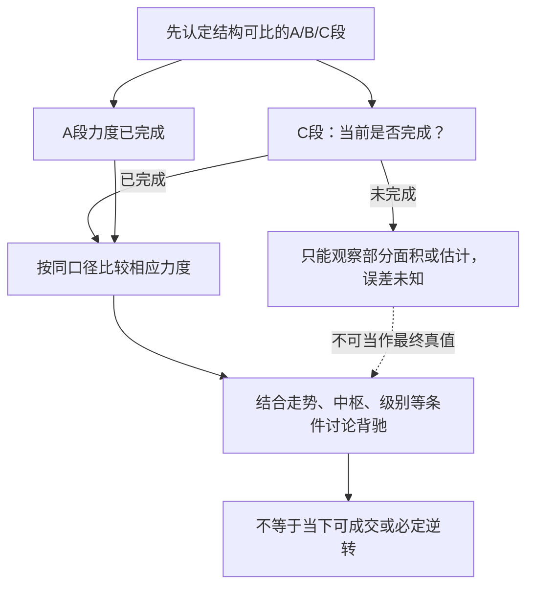
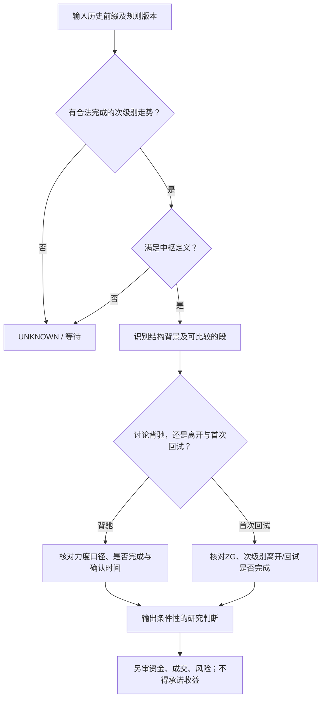

# 专题教程二｜一个连续案例讲清楚：中枢、背驰、三类买卖点怎样相互联系？

> **这是条件教学，不是交易信号。** 本页全部价格数字、时序、A/B/C段和“回试”都是**AI构造**，不对应原书图或真实市场；即使图上符合局部几何条件，也不能宣称作者的全部技术判据或盈利条件已经满足。引文依据既有首轮证据；原PDF图像尚有未核数值。读完应该知道：**什么先成立、什么必须等后面完成、为什么背驰≠MACD一拐就买、为什么三买≠突破就买。**

## 最短的知识依赖链

**先有按规则合法的走势类型，才能判中枢；先有中枢等结构背景，才谈相应的背驰比较/离开回试；确认结构后仍需要单独面对资金与成交现实。**


原书定位：[第17课卷一p.197](../../../knowledge/evidence/chanlun_lesson017.json) · [第20课卷一p.245—247](../../../knowledge/evidence/chanlun_lesson020.json) · [第21课卷一p.253—254](../../../knowledge/evidence/chanlun_lesson021.json) · [第24课卷二p.3—4](../../../knowledge/evidence/chanlun_lesson024.json) · [第27课卷二p.91—93](../../../knowledge/evidence/chanlun_lesson027.json)。

## 场景一：先“算出重叠”，再决定能不能叫中枢

**AI构造前提**：我们假设一套事先固定且合法的次级别构造规则，并由此确认连续的`A`、`B`、`C`三段；其区间分别为：

| 虚构走势 | 区间 | 到时点的身份 |
|---|---|---|
| A | [10,16] | t1才完成 |
| B | [12,18] | t2才完成 |
| C | [13,15] | t4才完成；在t3只是进行中 |

在`t4`，三段交集为`[max(10,12,13),min(16,18,15)]=[13,15]`。此算式演示**区间交集**；只要事先假设不成立，不能由三个数字自动“证明有中枢”。

```text
假设价格轴从低到高：
A    10 ├───────────┤ 16
B       12 ├───────────┤ 18
C         13 ├────┤ 15
共同区间  13 ├────┤ 15   ← 以下例子暂记上边界ZG=15
```

**AI视角**：中枢不是一个“看着盘整像矩形”的主观框，而是对**哪些有资格的连续走势有共同区间**的检查。第20课还提出中枢延续、新生、扩张的差别，此处没有完整模拟那些复杂情形。

## 场景二：同一根历史K线，在不同“已知时点”结论不同



这里`t1...t7`仅代表**事件依次发生**，不是原书行情交易日，也不是“在这些事件点已能按预期价格成交”。

## 场景三：第一次回试，为什么不等于“摸到边界就买”

**AI构造继续**：前面暂把中枢上边界设为`ZG=15`。之后假设有一个**完整的次级别向上离开**，其上沿到20；随后第一次完整次级别回试的低点为16。

```text
价格
 20                ╱╲      ← 完整的向上离开（已假设合法）
                  ╱  ╲
 16              ╱    ╲___ ← 第一次完整次级别回试低点16
 15 ────────────┼───────── ← 之前中枢上沿ZG=15
 13 ════════════╧═════════ ← 之前中枢区域[13,15]（示意，不是真行情）
         时间 →
```

**结构判定的简化重点**：`16>15`，所以在**我们预设的“离开走势”和“首次回试走势”都合法且完成**的前提下，满足第20课所述第三类买点的重要几何条件之一。

**千万注意**：只在实际K线跳到20以后、尚未回试完成时不能叫三买；也不能仅凭`16>15`就证明**完整三买**，因为次级别完成、序列身份和规则版本才是关键。

**同一段故事的三个反例**：

| 情形 | 看起来发生了什么 | 为什么不能直接标记三买 |
|---|---|---|
| R1：突破后还没回试 | 价格只向上走到20 | “第一次完整次级别回试”不存在 |
| R2：回试低点14 | 上涨后回撤进入`ZG=15`下方 | 不满足本例的关键上边界条件 |
| R3：第一次回试仍未完成 | 中途低点暂为16，后续还可能变动 | 不能拿未来确定的最低点提前认定 |

**重要的后续分叉**：原文第20课承认第三类买点之后**还可能转入更高级别盘整**。因此“满足第三买点条件”不是“今后必然单边上涨”的同义词。



## 场景四：背驰要比较“相应的走势力度”，不只是看到MACD背离

**第15、24、25课来源线索**：背驰与走势级别、趋势结构及相应分段比较有关；第24课谈A/B/C分段和MACD柱面积，对MACD的定位是**辅助**。[第24课卷二p.3—9](../../../knowledge/evidence/chanlun_lesson024.json) · [第15课首轮研究](../../../analyses/books/chanlun/chapters/lesson_015.md)。

想象已经按作者要求分别划好了**可比较**的A、B、C段，并且选定了同口径的力度量。如果C的推进仍然延续，但力度弱于相应的A，便进入背驰相关讨论；**这里的“同口径”“可比较”“完成”不能省**。

**AI教学数字，仅说明估计误差**：A段某辅助指标完成面积为`10`；C段尚未走完，目前面积`3`。第24课谈过用C段已出现面积乘二的经验估计，此时估计`6`，但C段未来可能增至`8`、`12`乃至其他数值。**`6`只是预测，不是未来已实现的面积**。



**AI独立理解**：背驰最有研究价值的部分，是试图表达**有结构背景的力度差异**；把所有背离都压成一个MACD金叉死叉信号，反而丢掉原问题。

## 场景五：第一、二、三类点不是“风险从大到小排列”的简单表

| 类型 | 在原书结构框架中的主要关切 | 初学者常犯的简化错误 |
|---|---|---|
| 第一类 | 原方向走势的衰竭/转折关联条件 | 看到绝对低价就当作一买 |
| 第二类 | 第一类点后次级别回试及相关确认条件 | 回踩一次就必然是二买 |
| 第三类 | 已确认中枢离开后的首次完整次级别回试 | 一根K线突破箱体就叫三买 |

第21课主张“三类点完备性/绝对安全”，但**分类穷尽性**和**真实盈利保证**属于不同待证明命题；存在的“二、三类点可重合”问题也不能靠这张表裁决。[第21课原证据](../../../knowledge/evidence/chanlun_lesson021.json)。

## 读完应该得到的“判定流程”，而不是下单公式



### 三道自测题

1. **t3的C段尚未完成，能否使用t4的最终区间判中枢？** 不能，属于时间穿越。
2. **`ZG=15`，第一次完整回试低点16，是否就证明市场一定上涨？** 不能；它只是特定合法条件下的几何判断之一，后续可能有不同路径。
3. **把未完成MACD面积`3`乘二成`6`，意味着完成面积必为6吗？** 不意味着；这是估计而非观测。

**延伸**：[教程一：递归与终完美](05_专题教程_走势分解与终完美.md)；[教程三：底层构造](07_专题教程_从分型到线段中枢.md)；[原书未审图与来源风险](../00_REVIEW/DETAIL_COVERAGE_GAPS.md)。所有行情检验仍为`NOT_RUN`。
