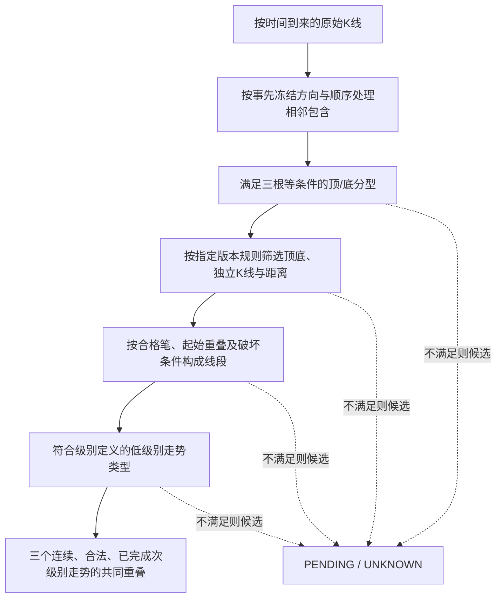
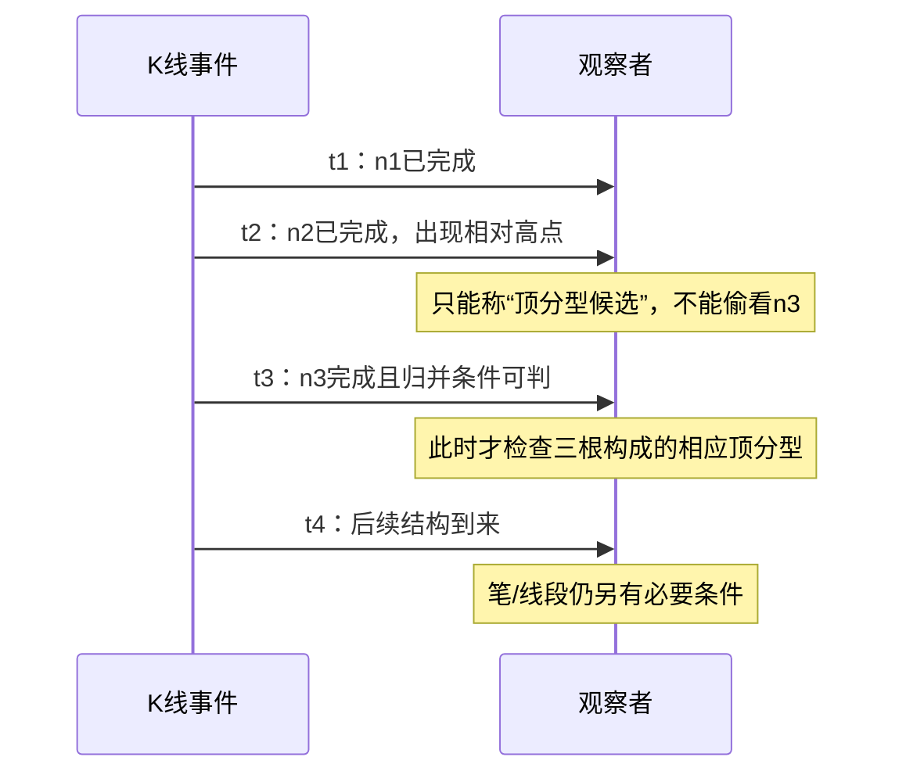
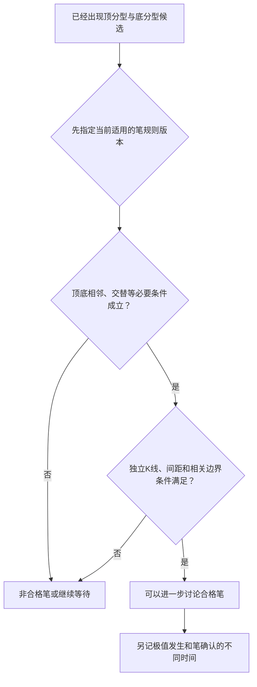
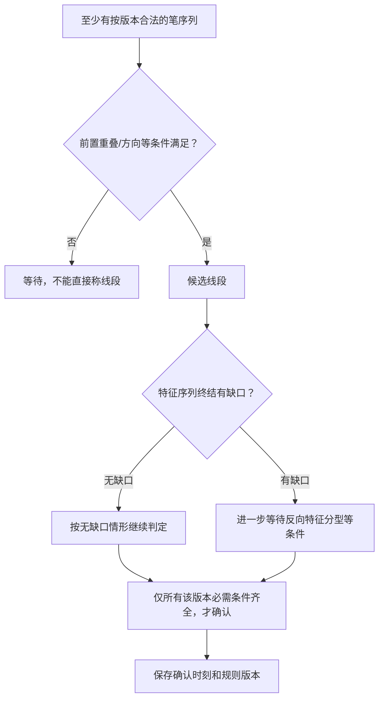
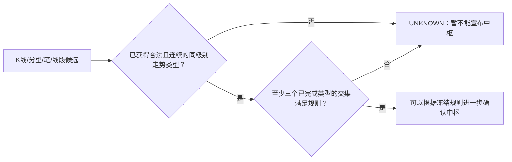

# 专题教程三｜把K线变成结构：分型 → 笔 → 线段 → 中枢，究竟经过几道门？

> 这是**带着你检查成立条件的教学演算**，不是“按这几张图即可自动生成唯一缠论笔线段”的承诺。第62、65、67、71、77、81课分散在连载不同时期，**规则版本和编辑附文混排**；本文仅用现有证据说明必要的判定思路，绝不把AI示意图冒充已核验原图或完整解析器。所有自造区间、K线高低价和笔片段均标注“AI构造”，无市场回测。

## 先把“层级图”读对



**不是一条“任何K线都必然立刻到中枢”的流水线**：每一步都有失败、未决、版本修订，甚至同一时间的多个候选解释。此图是**理解路径**，不声称原作者在第62课就给出了完整、无歧义的机器实现。

原始依据：[第62课卷三p.292—294](../../../knowledge/evidence/chanlun_lesson062.json) · [第65课卷三p.347—349](../../../knowledge/evidence/chanlun_lesson065.json) · [第67课卷三p.388—389](../../../knowledge/evidence/chanlun_lesson067.json) · [第71课卷四p.71—72](../../../knowledge/evidence/chanlun_lesson071.json) · [第77课卷四p.158—160](../../../knowledge/evidence/chanlun_lesson077.json) · [第81课卷四p.241](../../../knowledge/evidence/chanlun_lesson081.json)。

## 第一道门：先处理包含，再谈分型

【作者规则摘要】第62课讨论相邻包含K线的方向性处理，第65课强调**按时间顺序、在确定方向后逐根处理**，而不是无差别地合并一堆区间。[课62](../../../knowledge/evidence/chanlun_lesson062.json) · [课65](../../../knowledge/evidence/chanlun_lesson065.json)。

【AI构造小例】假设原始相邻K线为：

| 时间 | 最低 | 最高 | AI观察 |
|---|---:|---:|---|
| k1 | 5 | 10 | 先到 |
| k2 | 6 | 9 | 数值区间严格落在k1内 |
| k3 | 7 | 11 | 新高、低点也更高 |

**不能做的事**：把k1、k2“属于同一个东西”当成一个没有方向、没有先后顺序的等价类，再把k3随意并进来；归并结果要按原文所述的**方向约束和相邻处理顺序**判断。

**数学纠错，特别重要**：普通集合/区间“包含”`A⊇B`且`B⊇C`时，**数学上当然**有`A⊇C`。第65课所用“包含关系不传递”的论述，应放到**按序归并的特殊操作语境**理解，**不能**拿来否定集合包含的传递律。书中语句本身是否给出完整严密的操作证明，仍应回到原文核查。

```text
原始 K 线：k1 → k2 → k3 → …
  │          │
  └──包含候选┘
     ↓ 需要方向+当时已有的历史来决定归并
标准化序列：N1 → N2 → …
     ↓ 只能再拿相邻的合法输出判分型
```

**AI看见的研究价值**：把“局部归并”作为时间有序的过程，而不是对所有K线一次性做集合聚类；这和数据流处理非常像，但类比不是作者的数学定理。

## 第二道门：顶/底分型到底在什么时候能知道？

【作者定义摘要】第62课卷三p.292起用三根符合条件的K线高低点关系界定顶/底分型，并需先处理包含。[课62证据](../../../knowledge/evidence/chanlun_lesson062.json)。

**AI构造的顶分型简图**（为了说明“第三根完成才能检查”，不是复写原作者全部条件）：

| 标准化K线 | 最高 | 最低 | 当时状态 |
|---|---:|---:|---|
| n1 | 10 | 5 | 已完成 |
| n2 | 14 | 8 | 已完成；此刻只是可能的中间高点 |
| n3 | 11 | 6 | 后来完成；符合本例“中间更高”的直观关系 |

```text
         14        ← n2：局部最高点在这里
        /  \
 10 ___/    \___ 11  ← n3完成后才知道右侧比较结果
        n2  n3
时间：   n1→n2→n3
```

**关键区别**：n2的“极值发生时刻”≠ 三根都完成、可以进行分型条件检查的“确认时刻”。如果n3后来变化或此前有包含仍待处理，标签就不能提前固定。



## 第三道门：连起顶底也未必形成“笔”

【作者规则摘要】第62、65、77课围绕笔提出**顶底交替、独立K线与必要距离/结构约束**。第81课汇编中卷四p.241又出现**独立署时2007-09-18**的笔修订材料，不能把它当作第77课原发同期条件。[课77证据](../../../knowledge/evidence/chanlun_lesson077.json) · [课81证据](../../../knowledge/evidence/chanlun_lesson081.json) · [规则版本史](../../../catalog/chanlun_rule_history_v1.json)。



**反例式教学**：你画出一条从n2高点到下一根低点的斜线，不等于按指定版本规则已经形成笔；缺失独立K线或符合约束的底分型时，应返回`PEN_PENDING`而不是“为了让图好看强行画一笔”。

**AI最关心的细节**：如果你今天用“新笔”规则重画2007年较早时点的图，要注明“**事后采用后发规则重评**”；不能把该结果冒充当时已公开且已用的规则。

## 第四道门：三笔为什么不自动就是一条线段？

【原作者来源摘要】第65、77课要求线段开始的前三笔具有重叠等结构条件，并且还需要处理线段破坏；第67课用特征序列及有无缺口的不同终结条件。[课65证据](../../../knowledge/evidence/chanlun_lesson065.json) · [课67证据](../../../knowledge/evidence/chanlun_lesson067.json)。

**AI构造的必要条件对照**：

| 看起来像什么 | 还应检查什么 | 安全的状态 |
|---|---|---|
| 三笔连接起来 | 起始三笔是否符合作者要求的重叠及方向性 | 不齐全则`SEGMENT_PENDING` |
| 出现反向笔 | 特征序列是否符合线段破坏判据 | 候选，而非自动确认 |
| 发生特征序列缺口 | 有缺口时是否形成后续独立反向特征分型 | 可能需要延后确认 |
| 辅助线帮助识别分型 | 该元素是否真属于当前严格特征序列 | 仅辅助判断，不能擅自并入 |



**容易错的时钟问题**：一个最终被认定的线段端点可能在`t2`出现，却要到`t5`才具备正式确认所需条件。把回看图上的`t2`直接当成`t2`可交易的信号，属于典型前视。

## 第五道门：第71课的“辅助元素”不能混成正式成员

【原作者规则摘要】第71课卷四p.71—72明确讨论同一特征序列内部的包含，以及转折附近可以帮助识别、却**不一定属于**前后严格特征序列的元素。[课71证据](../../../knowledge/evidence/chanlun_lesson071.json)。

```text
为了判断“有没有转折”，可能临时观察到辅助笔 X；
但“X 可以拿来帮助判断” ≠ “X 一定是正式序列的成员”。

判断依据：      S1、S2、X（辅助观察）
严格成员登记：  S1、S2、…（是否包含X必须另按规则验证）
```

**AI原创类比**：法庭可以**看见**某条背景线索，不等于它被允许直接当成某条法定证明要件；同理，结构“判定时参考了”与“结构正式包含了”是不同类型关系。这是教学类比，非作者原话。

## 第六道门：已经形成线段，为什么仍不能立即叫“中枢”？

前文从K线推进到线段，是为了帮助读者看见构造对象的逐层约束；但第17课定义中枢的是**合法、连续、已完成的次级别走势类型**，**不是“随便找三条线段区间”**。

**AI构造的最后一关**：假设另有严格同级别解析，把三个已完成走势单元判成`W1=[10,16]`、`W2=[12,18]`、`W3=[13,15]`，才有`[13,15]`的共同交集。若只有线段候选、走势类型还未合法构造，就**停在未知**。



## 一张看完就能带走的“时点/版本账本”

| 输出对象 | 最早候选从何时出现 | 最早可确认的时机 | 必须记录 |
|---|---|---|---|
| 分型 | 中间高/低点已经出现 | 右侧K线与包含规则都满足时 | 原始K线、归并方向、`rule_version` |
| 笔 | 可能的顶底关系出现 | 指定规则版本的顶底/间距等条件都满足时 | 规则版本、两端位置、`confirmed_at` |
| 线段 | 若干合格笔出现 | 起始与终结必要条件满足，有缺口时可能延后 | 特征序列严格成员、缺口、时间戳 |
| 中枢 | 多个可能重叠的低级别单元出现 | 已合法完成的三个连续同级别走势满足条件时 | 各段来源、区间、级别、完成时间 |

这里的`confirmed_at`是**AI建议的研究记录字段**，不是原书发布过的一整套标准机器接口。

### 自测（防止“看起来像”代替定义）

1. **n2最高价14时就能说确定顶分型吗？** 不行，至少要等右侧符合要求的第三根和处理包含。
2. **三笔就一定组成线段吗？** 不行，还需要起始重叠、方向、特征序列及终结等相关规则。
3. **按新笔规则重画旧行情，能说当时就知道这版规则吗？** 不能；必须记录规则公开与采用时间。
4. **三个线段候选价格重叠，就等于正式中枢吗？** 不行；第17课要求合法、连续、已完成的次级别走势类型。

**AI结论**：真正的难点不在于图形是否漂亮，而在于“**每一层的合法证明＋版本＋当下信息截止点**”。完整解析器、所有价格图的终审、实际行情结果**均未完成**，相关未来形式化命题仍为`NOT_RUN`。

延伸：[教程一：分解定理](05_专题教程_走势分解与终完美.md) · [教程二：中枢与买点](06_专题教程_中枢背驰与三类点.md) · [原PDF复核缺口](../00_REVIEW/DETAIL_COVERAGE_GAPS.md)。
