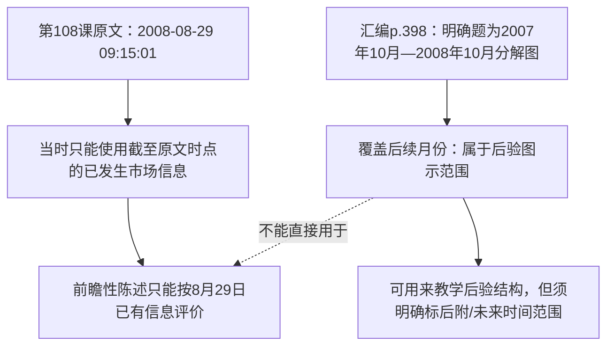

# 《缠论》原始PDF实页核对：哪些图看清了，哪些结论仍不能说？

> **这是对原始PDF像素的新增实页观察，不是合成行情或纯摘要。** 本轮从仓库的**原五卷PDF中三卷**提取了20个重点**物理PDF页**，SHA-256与既有[源清单](../../../reports/source_inventory/chanlun_20261107_verified.json)一致；使用PyMuPDF 185 DPI全页和300 DPI重点嵌图区渲染，经实际图像阅读对重点内容目视检查。**没有核对五卷全部图表，也没有独立历史行情或回测。** 原图本身仍保留在唯一的 [ChineseBooks/缠论](../../../ChineseBooks/缠论)；本目录不复制原PDF或高分辨图。所有临时渲染在[GitHub Actions #42470378489](https://github.com/CrazyA1ice/TradeBooksInAIsEyes/actions/runs/42470378489)的7天保留附件中，过期后可按[渲染工具](../../../tools/render_chanlun_priority_original_pages.py)再生成。

**审阅术语**：
- `PAGE_RENDER_HASH_VERIFIED`：源PDF SHA/页数匹配，指定页成功渲染；**不是**“已看清图上全部字”。
- `SELECTED_LABEL_VISUALLY_READ`：本页列出的**具体文字或数值**已在渲染原图上亲眼辨认，并与正文出处对照；只对列出内容成立。
- `EDITORIAL_OR_LATER_SOURCED`：图中明确存在其他署时、署名或后发内容，不得自动归入本课首发作者当时的知识。
- `FINE_CHART_NOT_EXHAUSTIVE`：图上**其他每一根线、每一个价位、每一种笔和线段分解**未完全独立核定。
- `NOT_RUN`：所有涉及收益、走势预测与样本外检验**未执行**。

## 本轮原页审阅规模与来源保证

| 原始来源 | PDF SHA-256（原书固定） | 本轮渲染的物理页 | 主要看什么 |
|---|---|---|---|
| [卷一](../../../ChineseBooks/缠论/缠论_卷1.pdf#page=30) | `0a402e19bbcabc24a5d031b047aeebcf96cdb7f777d2462cc7e5b28ed121b865` | **30** | 第9课图片的真实类型 |
| [卷三](../../../ChineseBooks/缠论/缠论_卷3.pdf#page=257) | `fad3474e103353f6f67799aefec8c9fba28c9615c0c77a5c67fcbf2b6b4f8a7a` | **162、254—257、292—297、300—301** | 第53课2009插入；第59课图文对应；第62课图例版本 |
| [卷五](../../../ChineseBooks/缠论/缠论_卷5.pdf#page=395) | `6ea9d7fb45864494d37cc7152a335d656516802f8bdf95c93509d7b742e2ec65` | **225、395—398、400** | 第100课“娇注”；第108课底部图与后发时间 |

合计**20个指定物理页**。所列SHA与源清单一致；这是**部分内容的目视检查**，不是整章所有页面和全部图内数字的通关证书。物理页和扫描图底部印刷页码常差2页，统一按PDF从1起的页序引用。

## A｜第9课：此前“第30页是数学公式图片”的归类需要修正

**本次实际看到**：[卷一PDF物理p.30](../../../ChineseBooks/缠论/缠论_卷1.pdf#page=30)的唯一大幅嵌图，标题清楚显示**“日K线图——武钢JTB1(580001)”**，上半为K线及5/10/30 PMA均线、下半为成交量；本页**没有在图中看到30%×40%×30%这样的数学算式**。该页原生文本只有很少页眉页脚，不能据“低文本页”把图内容自动推断成数学正文。

**不能误读**：第9课的30%、40%、30%及3.6%仍可由[第9课PDF p.28—29的正文证据](../../../knowledge/evidence/chanlun_lesson009.json)支持；**数学算式的位置与p.30大幅图的性质不是一回事**。此前对p.30的“数学正文图像”描述不准确，已在规范研究中更正。

**状态**：p.30 `SELECTED_LABEL_VISUALLY_READ`（图名、股票代码、K线/成交量分区）；`FINE_CHART_NOT_EXHAUSTIVE`（所有日线/均线数值未逐个核读）。p.28—29数学条件仍需独立的概率事件审计，图像不证明交易胜率。

## B｜第53课：p.162同页出现2009年署时，不能倒填2007年

[卷三PDF物理p.162](../../../ChineseBooks/缠论/缠论_卷3.pdf#page=162)文字确实显示一篇**独立署时“(2009-01-05 12:00:58)”**的讨论，在原第53课2007-05-23的正文之后插入。此页并非图片页，来源时间来自**实际原页的可提取文本和渲染阅读**。第53课后期材料的全部作者/编辑归属仍须以p.163—165等页的全文和署名进一步判断。

**状态**：`SELECTED_LABEL_VISUALLY_READ`（日期）。`PROVENANCE_LIMITED`（整段后附身份、所有后期细节并未完全复核）。不要把2009年的说法写成2007年的原创规则。[第53课规范研究](../../../analyses/books/chanlun/chapters/lesson_053.md)。

## C｜第59课：两个极值在p.257正文，p.254—256是真实有编号的分钟图

- [卷三p.254](../../../ChineseBooks/缠论/缠论_卷3.pdf#page=254)：一幅深色行情截图，包含分钟走势、指标副图及局部编号/数值标注。
- [卷三p.255—256](../../../ChineseBooks/缠论/缠论_卷3.pdf#page=255)：两页分钟走势图可见**20—45**等结构编号、与1分钟中枢和第三类点相关的原图文字；这是**真实汇编中的行情截图**，不是我们之前为教学编造的数字。
- **[卷三p.257](../../../ChineseBooks/缠论/缠论_卷3.pdf#page=257)**：此页**无内嵌图像**，正文确实包含**“3994.57”和“3994.21”**两个数字，并讨论在整数精度与保留两位小数精度下，7—8—9走势的分段判定可能不同。

**关键区分**：p.257**正文的两个数字已独立核对**；不等于我们已把**7—8—9的每一个原始端点**在p.254—256的图上逐一定位，因为这批图的主要标号是20—45，而p.257引用的是“前面一课”的7—8—9。下一轮如果要把这两个价位准确落在图上，必须追溯**前一课**的原图，不能将当前图中的任何接近价位随意配给7/8/9。

**数值解释仍成立**：把3994.57和3994.21**向零截断到个位**会相等；**四舍五入到个位**则分别成为3995、3994。作者原文并未在本次查看的p.257把具体量化方法精确形式化，因此仍须声明比较方法。图像状态：`SELECTED_LABEL_VISUALLY_READ`（p.254—256可见走势标号和正文关系）＋`FINE_CHART_NOT_EXHAUSTIVE`（未核完所有分钟价签）；价位属于**p.257文字已证**。[第59课研究](../../../analyses/books/chanlun/chapters/lesson_059.md)。

## D｜第62课：不是一张“原作者一手完成的笔定义插图”

本轮看过[卷三p.292—297](../../../ChineseBooks/缠论/缠论_卷3.pdf#page=292)和[p.300—301](../../../ChineseBooks/缠论/缠论_卷3.pdf#page=300)的实页，发现至少三个需要区分的图层：

1. **p.292—293**：出现**相同或高度重复**的黑白示意图组，图内可辨认数字1—9，以及“结合律”“包含关系”“非包含关系的三根K线完全分类”“线段的基本形式”“线段破坏的基本形式”等标签。这是**抽象结构图**，不是带证券代码和成交价轴的历史走势图。部分内部小线条的分型判定还需按原文字逐例核准。
2. **p.295**：图内右下角清晰标有**“张大山习作”**，旁边同页正文另起标题“**新笔定义**”。这意味着该图至少有**独立图作者署名线索**，不能简单称它为缠中说禅本人当年发表的一幅亲绘原图；新笔材料的独立发布时点仍未全部确定。
3. **p.297**：彩色图示顶部可辨认“**FHSL 20080727**”，明显**晚于第62课2007-06-30的首发署时**。这证明本PDF页组中夹有后期绘制/标注的说明性材料，不能把该图的绘制日期回填到2007年6月原作者当时知识。p.300—301则是**无价格轴**的抽象线段变化/类等价图示，不能冒充任何历史A股价位。

**状态**：上述**可辨认图名、署名、署时**为`SELECTED_LABEL_VISUALLY_READ`；独立画者身份与笔规则法律式归属保留`EDITORIAL_OR_LATER_SOURCED`。**不能从本次看图推导出“旧笔和新笔哪个数学定义已被证明”**。[第62课已有研究](../../../analyses/books/chanlun/chapters/lesson_062.md) · [规则版本历史](../../../catalog/chanlun_rule_history_v1.json)。

## E｜第100课：p.225的“娇注”在原版页上确实可见

[卷五PDF物理p.225](../../../ChineseBooks/缠论/缠论_卷5.pdf#page=225)有清晰的**“（娇注：实际走势出现5分3卖后扩展5分中枢并且碰到前5分中枢……不属于禅师分类里任何一种）”**插入式文字，紧邻作者对第三类卖点成立与否的分支讨论。这里可以确定**这段注释确实存在于PDF该页**，并不只是早先研究者凭空写出的反例。

**但是**：“娇注”在该页出现，不能证明其对历史走势的再分段**一定正确**，也不能证明与作者逻辑分支的数学冲突已经由独立行情裁决。状态：`SELECTED_LABEL_VISUALLY_READ`（注释身份提示与主要意见）＋`PROVENANCE_LIMITED`（后发表时及市场验证）。[第100课研究](../../../analyses/books/chanlun/chapters/lesson_100.md)。

## F｜第108课：原图显示“未来十月”，这是重大当下性边界

**文章原始时点**：[卷五PDF物理p.395](../../../ChineseBooks/缠论/缠论_卷5.pdf#page=395)题头载**2008-08-29 09:15:01**；作者讲“底部”的两种定义以及分型区间、第一类买点与中枢后续第三类点的不同条件。

**实际渲染原图所见**：

| 源图页 | 图上直接辨认的内容 | 审读意义 |
|---|---|---|
| [卷五p.396](../../../ChineseBooks/缠论/缠论_卷5.pdf#page=396) | 上证指数**月线**及带注释高点“**2008/07 高点2952**”、低点“**2008/08 低点2284**”；还有6124.04历史顶部 | 本课文字讨论的2952/2284与此页月线图**有直接图文对应**；但其余小字与指标数值未逐条核完 |
| [卷五p.397](../../../ChineseBooks/缠论/缠论_卷5.pdf#page=397) | 上证指数**周线（前复权）**图中可见“**2601**”“**2523**”“**2284**”“**1664.93**”等标注 | **1664.93**作为后续低位已出现于汇编图，说明该图的信息范围可能**晚于**2008-08-29；不能直接用它重建作者8月29日当下判断 |
| [卷五p.398](../../../ChineseBooks/缠论/缠论_卷5.pdf#page=398) | 图的标题清楚写“**2007年10月—2008年10月分解图**”，右下有**1664.93**，图中是**带分解框的日线及MACD** | **明确覆盖2008年10月**，晚于原文2008-08-29发表日期；**这是一幅后验时间范围的图**，绝不能声称是2008年8月29日原作者已知的完整走势图 |
| [卷五p.400](../../../ChineseBooks/缠论/缠论_卷5.pdf#page=400) | 日线前复权图有“**3300附近中枢**”“**2523**”“**2403**”与MACD图，另有低位数字 | 能确认所列较大文字标签在汇编图中存在；与8月29日原文的同一时点关系须单独证明 |

**核心纠错**：第108课的**2008-08-29作者原文**、汇编在此页附近的**后来历史走势图**、以及我们的**AI教学图**是三个不同层。原图中出现了2008年10月的分解并不能反证作者8月底当时对未来的任何“预测准确率”，反过来也不能将后来图中的走势拿来为作者8月的结构判断提供所谓**当时已经可知的证据**。

**状态**：p.396的2952/2284与p.397的周线较大文字、p.398的时间标题**获得`SELECTED_LABEL_VISUALLY_READ`**；图中每根细小K线、MACD柱和作者/编者随后加入内容的正式发表身份**没有完整核验**，保留`FINE_CHART_NOT_EXHAUSTIVE`+`PROVENANCE_LIMITED`。本次只给出**历史时间范围的客观不兼容性**，不预测收益。[第108课规范研究](../../../analyses/books/chanlun/chapters/lesson_108.md)。

---

## 一张区分“实际已核”和“仍需核”的验收表

| 检查目标 | 本轮结果 | **不得升级**的结论 |
|---|---|---|
| 20页来自规范PDF、源SHA匹配、可复现的渲染附件 | `PASS` | 不代表108课全部图片逐页看过 |
| 第9课卷一p.30图名与类型 | `SELECTED_LABEL_VISUALLY_READ` | 不能把p.30当数学公式图片 |
| 第59课卷三p.257的两处正文数字 | `SOURCE_TEXT_REVIEWED` | **不是7—8—9图上每个端点已核** |
| 第62课p.295“张大山习作”与p.297“FHSL 20080727” | `SELECTED_LABEL_VISUALLY_READ` | 不能将后期图作者/日期回填为2007原始作者规则 |
| 第100课卷五p.225“娇注” | `SELECTED_LABEL_VISUALLY_READ` | 不能认定其行情反例已独立实证 |
| 第108课p.396的2952/2284与p.398的2008年10月标题 | `SELECTED_LABEL_VISUALLY_READ` | 不能用10月图评估8月29日实时可知性 |
| 第59课所有微观线段、62课所有新旧笔定义的唯一解析、108课全部指标数字 | `FINE_CHART_NOT_EXHAUSTIVE` | **尚不能宣称全部图片验收完成** |
| 所有市场回测与真实交易复现 | `NOT_RUN` | 无收益/成功率结论 |

**为什么没有把20张原页复制进仓库**：它们已经存在于[原PDF](../../../ChineseBooks/缠论)内，重复存放会制造难以维护的版本副本。用户要看真正的图，可直接从PDF按**物理页码**定位；临时高DPI渲染仅用于本次审读，短期CI附件可按原哈希再生。**下一步应该再找第58课7—8—9真正的图页、核第62课后附图的完整作者与日期，并把第108课的前瞻/后验图分开，而不是继续生成更多假想行情。**
