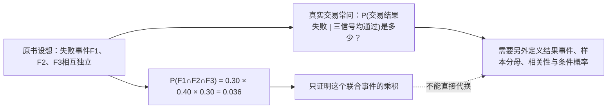
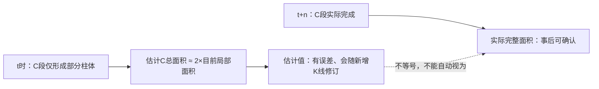
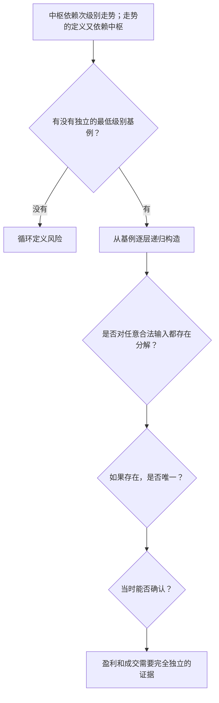
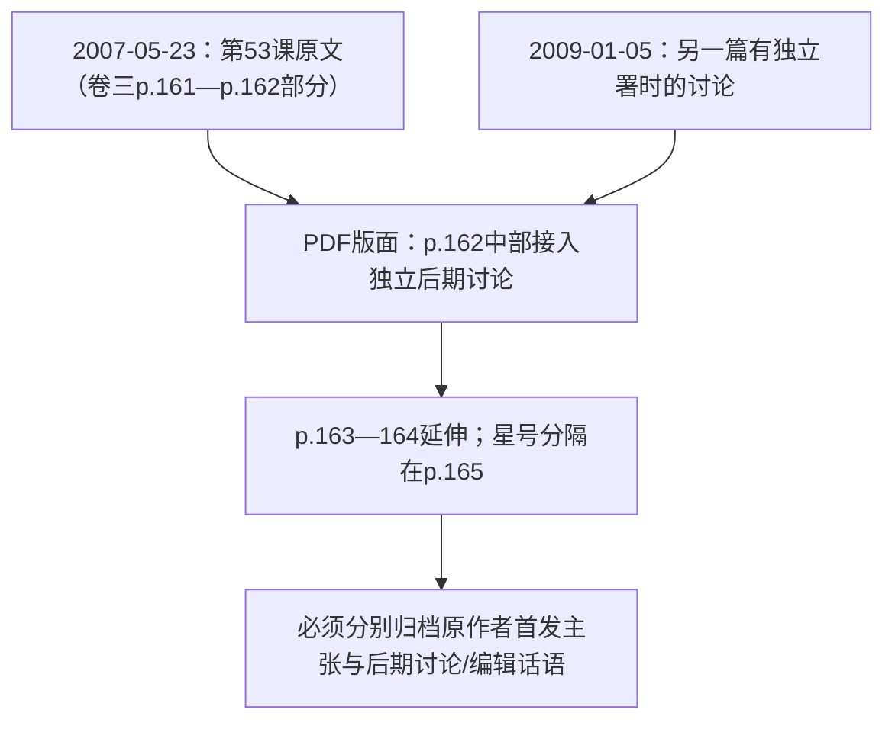
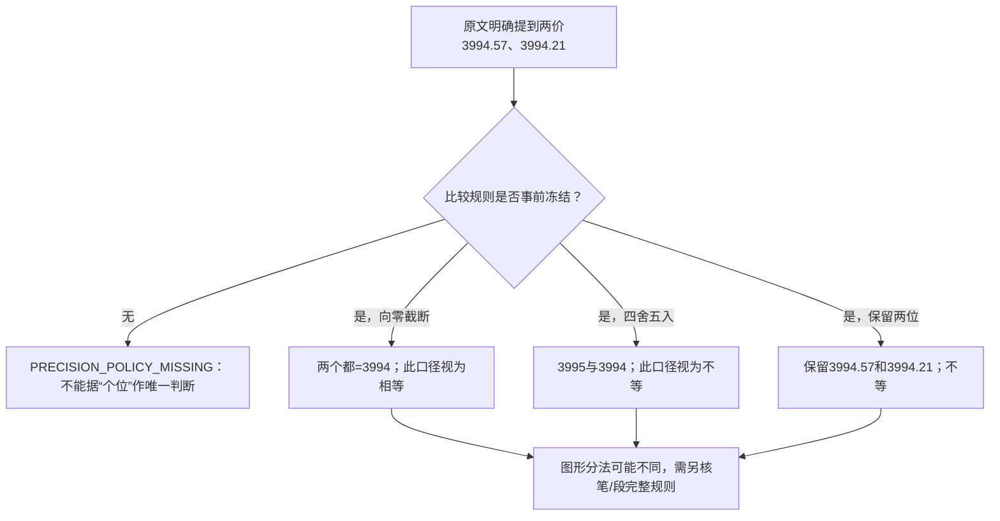
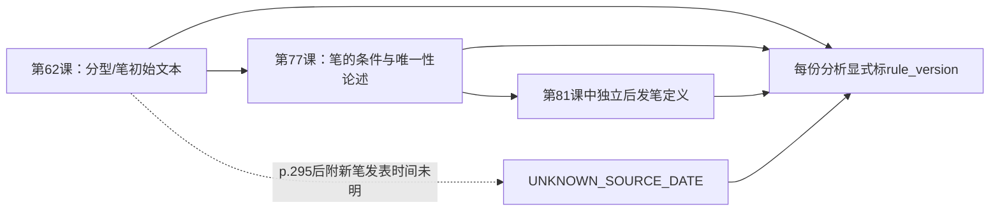
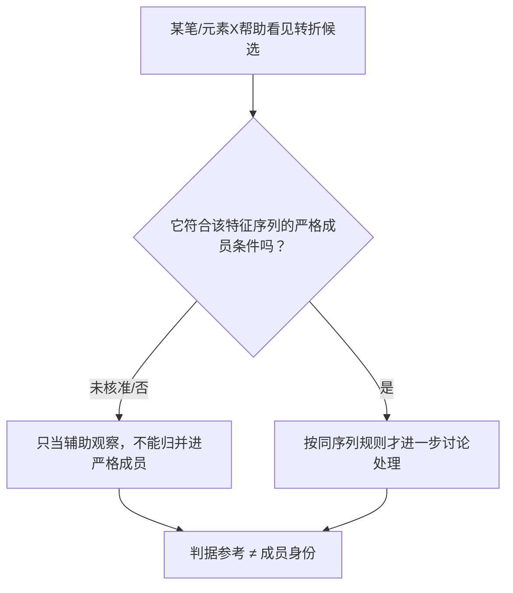
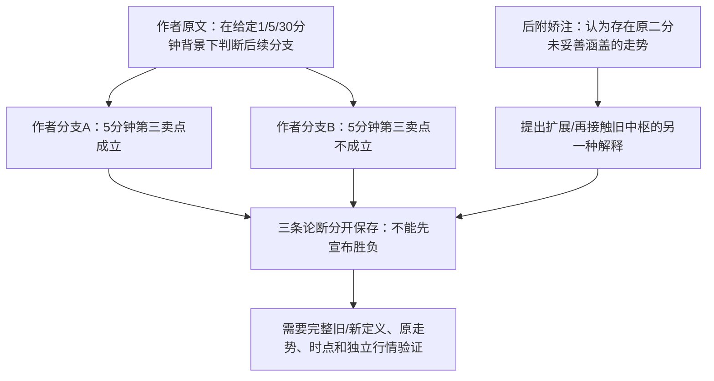
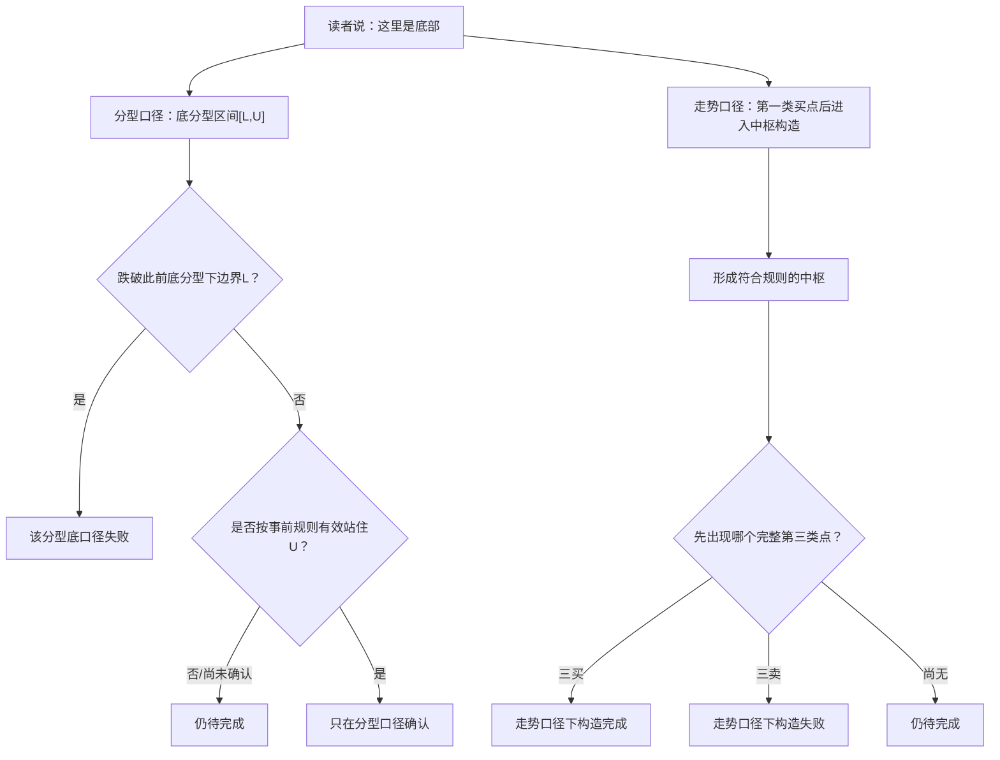

# 《缠论》原书关键案例细读｜原文说什么、AI看出什么、哪张图还不能定论？

> **阅读定位**：前面的[三套专题教程](README.md)和[逐步播放器](08_交互式演示阅读卡.md)主要使用**AI虚构教学数据**。这一篇反过来，从原书**有页码的实际正文命题、具体数字、后附修订与异议**出发，回答“原书到底用这个例子想证明什么？证据真能支持多强的结论？”。本轮**复查了仓库已有章节研究与结构化源证据**，没有重新逐页打开五卷PDF图片。**凡涉及原图细微标价、分段线或编辑版面，均明确列为待核；本页的Mermaid是AI教学重画，不是原书图片或原始行情复刻。** 未接入市场数据，所有实验题目仍为`NOT_RUN`。

## 先看这九个真实来源案例

| 定位 | 原书给出的具体对象 | AI应帮你理解的核心 | 证据状态 |
|---|---|---|---|
| [SRC-009](#src-009) | 第9课卷一PDF p.28—30：30%、40%、30%、3.6% | 数学乘积与“选中后交易失败率”可能是两个事件 | 正文已研究；p.30图片`VISUAL_LIMITED` |
| [SRC-024](#src-024) | 第24课卷二p.3—4：A/B/C与未完成C段柱体面积估计 | 观察值与预测量的时间边界 | 正文已研究；图示`VISUAL_LIMITED` |
| [SRC-035](#src-035) | 第35课卷二p.291—293：递归基例、两条分解定理、结合律 | 解除循环定义不等于证明唯一性 | 正文已研究；图示`VISUAL_LIMITED` |
| [SRC-053](#src-053) | 第53课卷三p.161—165：2007原文与2009后附讨论 | 版本时间决定作者原意的边界 | 文本署时有线索；`PROVENANCE_LIMITED` |
| [SRC-059](#src-059) | 第59课卷三p.257：3994.57与3994.21 | “取到个位”也有不同数学算法 | 正文数字已有来源；原图价签`VISUAL_LIMITED` |
| [SRC-062](#src-062) | 第62、77、81课：笔定义的前后版本 | 规则版本本身就是分析条件 | 正文有证据；部分原图及插入时间`LIMITED` |
| [SRC-071](#src-071) | 第71课卷四p.71—72：辅助特征元素与严格成员 | “拿来判断”不等于“属于最终结果” | 正文已研究；细小图价`VISUAL_LIMITED` |
| [SRC-100](#src-100) | 第100课卷五p.224—225：作者路径与“娇注”异议 | 并存的冲突命题不应自动裁决 | 编者异议有文本依据；独立行情`UNVERIFIED` |
| [SRC-108](#src-108) | 第108课卷五p.395—399：分型边界底与一买—中枢路径底 | 同一“底部”用词有不同完成条件 | 正文可定位；p.396—398原图`VISUAL_LIMITED` |

页码均为**PDF物理页（从1起）**；实际PDF保存在[唯一原书目录](../../../ChineseBooks/缠论)。读者可通过每节的卷PDF链接定位相应物理页；GitHub PDF的页跳转效果随浏览器而异。下面用“**原书线索SOURCE → AI大白话 → 条件图 → 不能得出的结论 → 待核证据**”的顺序阅读。

---

## SRC-009｜多重筛选的3.6%从何而来？

**【SOURCE｜第9课卷一p.28—29】** 作者以三个独立程序的失败率30%、40%、30%为例，乘起来得到**3.6%**，表达用不同信息来源交叉甄别的思路；正文同时强调资金管理与退出。[第9课原证据](../../../knowledge/evidence/chanlun_lesson009.json) · [独立七重研究](../../../analyses/books/chanlun/chapters/lesson_009.md) · [卷一PDF](../../../ChineseBooks/缠论/缠论_卷1.pdf#page=28)。

**【AI直白理解】** “同时犯三种彼此独立的错误”的概率可以相乘。但**筛选以后买入的股票又失败的概率**，通常是另一个问题。前一个叫联合事件概率，后一个叫**在三个信号都通过条件下的失败率**。

**【AI审视】** 数学乘法本身没错；逻辑跳步在于**这三种“程序失败”是否真的独立、它们同时失败是否恰好等价于最终组合交易失败**。同名“失败率”不意味着概率事件相同。

**【证据状态】** `SOURCE_TEXT_REVIEWED`；p.30数学图片 `VISUAL_LIMITED`。

**【待核图像】** 卷一p.30有图片化数学内容，既有审计尚未独立校准图片。这里的3.6%引用的是p.28—29已有正文证据，**不声称p.30的所有公式已经验明**。具体反例见[已有概率审计研究](../../../experiments/protocols/chanlun_lesson009_probability_audit.md)。

---

## SRC-024｜MACD：未走完的C段为何不能当作最终事实？

**【SOURCE｜第24课卷二p.3—4】** 作者把**A/B/C走势段及MACD柱体面积**放在一起讨论背驰的辅助判断，并提到用“**已形成的C段局部面积乘二**”作整体估计的经验办法。[第24课证据](../../../knowledge/evidence/chanlun_lesson024.json) · [第24课研究](../../../analyses/books/chanlun/chapters/lesson_024.md) · [卷二PDF](../../../ChineseBooks/缠论/缠论_卷2.pdf#page=3)。

**【AI直白理解】** 你只看见电影前半段，却要估计整场时长——可以估计，但不能当成实际已经放完。MACD是作者的**辅助观察量**，不是完整背驰定义，更不是确定价格反转的开关。

| 观察时刻 | 真正已知 | 可以做什么 | 不可提前断言 |
|---|---|---|---|
| C段形成中 | 已形成柱体的局部面积 | 做带误差的估计、继续看结构 | “C段总面积已经是2倍局部面积” |
| C段按照另行规则完成 | 该段已形成柱体 | 用**一致的分段和指标口径**比较 | “背驰必然带来盈利反转” |
| 后续行情已走完 | 事后完整段和结果 | 回看估计是否准确 | 把事后面积记为先前已知 |

**【证据状态】** `SOURCE_TEXT_REVIEWED`；未逐张复核MACD原图 `VISUAL_LIMITED`。

**【待核图像】** 卷二p.5、7—8、10—15多张源图仍未逐图验证。此图解释的是**估计与完成的边界**，不是复制原书MACD曲线。未来真实行情验证`NOT_RUN`。

---

## SRC-035｜走势分解定理为什么需要最低层？

**【SOURCE｜第35课卷二p.291—293】** 作者明确指出如果中枢靠走势类型定义、走势类型又靠中枢定义，就有循环风险；他提出**最低级别约定（三笔连续同价成交）**、从低级别三段重叠向高一级递归构造，以及两条走势分解定理和**连接结合律**。[第35课证据](../../../knowledge/evidence/chanlun_lesson035.json) · [逐课详解](../../../analyses/books/chanlun/chapters/lesson_035.md) · [卷二PDF](../../../ChineseBooks/缠论/缠论_卷2.pdf#page=291)。

**【AI直白理解】** 不能先把“房间”定义成“若干房子里的部分”，再把“房子”定义成“若干房间”而没有最初的砖。作者是试图找到底层砖块，从小到大搭建。

**【AI审视】** 结合律`(A+B)+C=A+(B+C)`描述按时间连接时括号不改变底层顺序；**它本身不证明分段标签唯一**。从基例构造也不自动保证每条成交序列都能命中“三笔同价”的起点。这是本书值得分开研究的证明义务。

**【证据状态】** `SOURCE_TEXT_REVIEWED`；分解/结合律原图 `VISUAL_LIMITED`。

**【待核图像】** 已有正文/页级研究，卷二p.294—297等图未逐幅核准；不拿AI层级图替换原作者图示。更完整的递归教学见[专题教程一](05_专题教程_走势分解与终完美.md)。

---

## SRC-053｜同一页竟然混进两年后的讨论？

**【来源记录｜第53课卷三p.161—165】** 既有证据记录，第53课原文署时**2007-05-23 08:47:18**；卷三**p.162中部**接入题为《第三类买卖点再分辨（思考贴9）》、独立署时**2009-01-05 12:00:58**的后期讨论，持续至p.163—164；常见星号分隔却在p.165才出现。[第53课结构化证据](../../../knowledge/evidence/chanlun_lesson053.json) · [第53课详细研究](../../../analyses/books/chanlun/chapters/lesson_053.md) · [来源分层](../../../reports/source_inventory/chanlun_lessons051_055_source_layers.md) · [卷三PDF](../../../ChineseBooks/缠论/缠论_卷3.pdf#page=161)。

**【AI直白理解】** 想象一本2007年的课堂笔记，某一页中途插入2009年的独立答疑。**装订在一页**不代表**同一天讲的**，也不代表“后期质疑已经被原作者2007年预先回答”。

**【AI审视】** 这是**来源版本问题**，不是要你挑作者一方获胜。2009讨论对第三类点与次级别离开/盘整组合提出不同观察，具体归属应按署名、位置、编者角色继续核对；不能将后附材料改写为作者2007年的同时期原定义。

**【待核证据】** 已有版面署时和文字范围线索，但本轮未重开原PDF逐像素核对p.162分界，不将本篇升级为“原图与编者所有边界彻底核验”。源角色继续按`PROVENANCE_LIMITED`留痕。

---

## SRC-059｜3994.57与3994.21的精度陷阱

**【SOURCE｜第59课卷三p.257】** 作者举出**3994.57与3994.21**两个相近极值，讨论按不同观察精度会改变某些线段分法，并强调观察精度应**事前一致**。[第59课证据](../../../knowledge/evidence/chanlun_lesson059.json) · [逐课详解](../../../analyses/books/chanlun/chapters/lesson_059.md) · [卷三PDF](../../../ChineseBooks/缠论/缠论_卷3.pdf#page=257)。

**【AI直白理解】** 两个价只差一小截，但“忽略小数”到底采用哪种规则？如果不写清楚，**两个人都说按整数精度，却可能做出不同判断**。

| AI演示的十进制处理办法 | 3994.57 | 3994.21 | 两者相等吗？ |
|---|---:|---:|---|
| 保留原始两位小数 | 3994.57 | 3994.21 | **否** |
| 向零截断到整数 | 3994 | 3994 | **是** |
| 常规四舍五入到整数 | 3995 | 3994 | **否** |

**【AI审视】** 数值规则可以算清楚，但这张流程图**不宣称作者当年选择了截断或四舍五入中的哪一种**，也不宣称它单独确定原图7—8—9应怎样分段。原书特定分钟图的精确标签及最终线段仍需视觉复核。

**【待核图像】** 第59课卷三p.251—266多图页，既有记录只检查少量缩略图，细小数字`VISUAL_LIMITED`。这一对数字来自**可定位正文**，不等于原图每一处价位核实。

---

## SRC-062｜同一名词“笔”，为什么不能混用不同版本？

**【SOURCE和后附材料分层】** 第62课卷三p.292—295讨论分型、相邻包含处理和笔/线段必要条件；第77课卷四p.158—160又给出旧规则相关论证；第81课卷四p.241收录另一篇**2007-09-18 22:53:57独立署时**的后发“笔”规则讨论；第62课p.295后附“新笔定义”在现有资料中独立发表时间未完全明确。[第62课](../../../knowledge/evidence/chanlun_lesson062.json) · [第77课](../../../knowledge/evidence/chanlun_lesson077.json) · [第81课](../../../knowledge/evidence/chanlun_lesson081.json) · [规则版本登记](../../../catalog/chanlun_rule_history_v1.json)。

**【AI直白理解】** 你用同一个名词“笔”，但前后写了不同的成立条件。若不保留版本，同一段K线可能因为使用后发规则而被悄悄“重写”成另一种历史结果。

**【AI审视】** 这不是谁“术语正宗”的投票，而是**规则同一性与当下可知时间**问题。书内“唯一性”断言不能直接替代带版本、时间和边界冲突处理的证明。更多逐步图解见[从分型到线段教程](07_专题教程_从分型到线段中枢.md)。

**【待核图像】** 第62课卷三p.292—301部分图片仅有限预览；第81课存在精细价签未核；署时未知的段落不能自动回填到第62课首发时点。保留`VISUAL_LIMITED+PROVENANCE_LIMITED`。

---

## SRC-071｜帮助判定的一条线，为什么不一定是结构成员？

**【SOURCE｜第71课卷四p.71—72】** 原作者对线段**特征序列严格成员**、某些转折位置的辅助特征元素与同序列的合法包含提出区分。[第71课证据](../../../knowledge/evidence/chanlun_lesson071.json) · [逐课详解](../../../analyses/books/chanlun/chapters/lesson_071.md) · [卷四PDF](../../../ChineseBooks/缠论/缠论_卷4.pdf#page=71)。

**【AI直白理解】** 判断一道题时你可以看草稿，但**草稿上的辅助线不必然属于正式答案的结构组成**。原文里的一个辅助元素可以让你看清可能的转折，却不能因此被偷偷登记为前后任一特征序列的成员。

**【AI审视】** 程序化识别时“辅助输入”与“正式数据结构成员”是两种不同类型。不能因为画面里一条线被画在转折附近，就把它的成交价、缺口位置全部用于该特征序列的正式计算。

**【证据状态】** `SOURCE_TEXT_REVIEWED`；细小原图价签 `VISUAL_LIMITED`。

**【待核图像】** 卷四p.73—74已有预览/部分目视，p.73—76、79的细小价签尚未核；这幅判断图是AI概念图，**不是原图的标线重现**。

---

## SRC-100｜原作者的两条路径与编者提出的第三种

**【作者SOURCE｜第100课卷五p.224—225】** 原文结合30分钟、5分钟和1分钟级别，讨论较小级别变化之后，**5分钟第三卖点是否成立**的两类路径，以及按资金能力处理分支的要求。

**【编者后注｜EDITORIAL】** p.225的“娇注”对随后真实走势的归类提出不同意见：认为存在**5分钟第三卖点后仍扩展5分钟中枢并碰到旧中枢**的情况，并质疑作者的二分是否穷尽。现有报告未用独立历史分钟行情复刻，**不能宣称编者反例已经被外部验证**。[第100课结构化证据](../../../knowledge/evidence/chanlun_lesson100.json) · [第100课研究](../../../analyses/books/chanlun/chapters/lesson_100.md) · [来源审计](../../../reports/source_inventory/chanlun_lessons096_100_source_visual_review.md) · [卷五PDF](../../../ChineseBooks/缠论/缠论_卷5.pdf#page=224)。

**【AI直白理解】** 像教科书列出“如果A则走左路，如果非A则走右路”，之后有人拿着一个案例说“这两种分法都没有正确说明路径”。研究者不能删掉批评，也不能只凭一条后注就宣布作者整个系统已被推翻：**应该记录双方可检查的条件与来源身份**。

**【待核证据】** 第100课卷五p.225虽有此前页面目视记录，但本轮未重新检查后附原版版面，也没有真实行情独立复原，保留`PROVENANCE_LIMITED/UNVERIFIED`。

---

## SRC-108｜原文为何给了两种“底部”判定合同？

**【SOURCE｜第108课卷五p.395起】** 本课在**分型角度**用底分型低点、区间上沿和“有效站住”谈底的失败/成功；在**走势类型角度**讨论从第一类买点到其后中枢出现**首次第三类买点或卖点**之前的底部构造过程。[第108课证据](../../../knowledge/evidence/chanlun_lesson108.json) · [逐课研究](../../../analyses/books/chanlun/chapters/lesson_108.md) · [卷五PDF](../../../ChineseBooks/缠论/缠论_卷5.pdf#page=395)。

**【AI直白理解】** “底部”这个词同时可能指**一个局部范围有没有被守住**，也可能指**一整段走势是否按条件完成了构造**。两种定义不是同一种确认信号；拿一组底部统计数据不先说明是哪一口径，会把不同问题混为一谈。

**【时点提醒】** 原书2008-08-29当下讨论例子涉及**月线2284与2952**等历史价位，另外还有2601、2455等跨级别位置。**这些是原文时间点所讨论的条件边界，不是所有年代都适用的数值**；而2008年8月29日不可能提前知道9月月末究竟完成何种分型。

**【待核原图】** 卷五p.396—398、400及多处后附配图尚无完成的逐张精确视觉复核；**本节只引用现有正文中可定位的数值与条件，绝不宣称原图细小指标及支撑线已被重新验证**。`NOT_RUN`。

---

## 九个案例合起来，AI究竟看见了什么？

最有趣的不是哪一个术语最神秘，而是作者试图把“市场如何认知”转成**概率条件、结构语法、不同级别、精度政策、时间顺序与风险决策**时，具体碰到了哪种阻力：

1. **推理对象可能换了**：第9课从“独立失败事件乘积”跨到“组合交易失败率”；第35课从“可拼接”跨到“唯一解析”；第108课同一个“底部”在两种定义口径间切换。每一次都应该先问**到底还是同一个命题吗？**
2. **信息时点可能换了**：第24课“已观测部分MACD”与“C段未来总量”；第53课“2007原文”与“2009后附”；第62/81课“旧规则”与“后发笔定义”。每一次都应该先问**当时真的已经有这个信息吗？**
3. **数据对象可能换了**：第59课“真实两位价”与“某种整数化价”；第71课“辅助元素”与“严格成员”；第100课“作者原分支”与“编者建议的解释”。每一次都应该先问**这里究竟以哪个对象/角色为准？**

这是AI根据已知来源作的**跨案例独立综合**，不冒充作者自己发表的一条“九课统一定理”。

### 怎么继续复核，而不让验收目录堆满过程副本

| 高价值原页 | 为什么需要原PDF高分辨率目视 | 目前证据水平 | 何时才允许把状态升级 |
|---|---|---|---|
| 卷一p.30（9课） | 数学正文部分在图像上，可能影响精确原式 | `VISUAL_LIMITED` | 看清全文算式、上下文，记录页码与不同声音 |
| 卷三p.257及同课图页（59课） | 细小极值标签和线段连接可能因图像精度改变 | `VISUAL_LIMITED` | 核准每一目标价格标注、图上角色与正文关系 |
| 卷三p.292—301（62课） | 原始/后附笔规则和分型图表需分别确认 | `VISUAL_LIMITED + PROVENANCE_LIMITED` | 明确每张原图/附文的版本、发表边界 |
| 卷四p.73—79（71课） | 辅助元素与严格成员的图上位置 | `VISUAL_LIMITED` | 独立核图形状、成员定义与小数价签 |
| 卷五p.224—225（100课） | 作者/编者争论的位置及历史走势支持 | `PROVENANCE_LIMITED` | 核对书页身份与原行情，分别保留双方结论 |
| 卷五p.396—398（108课） | 原图与2284/2952等跨级别条件关系 | `VISUAL_LIMITED` | 高分辨图、日期、指标文字及完整时间因果复核 |

**诚实验收**：本文件完成的是**已有原文证据的深入教学重构与冲突对照**，不是对上表六批原图已经完成验证。需要更多具体内容，可点开每节规范原始研究，也可回到[11处优先覆盖缺口](../00_REVIEW/DETAIL_COVERAGE_GAPS.md)。**所有新的数学示意和Mermaid都属于AI解释，不是原著附图；未测试的市场命题继续`NOT_RUN`**。
