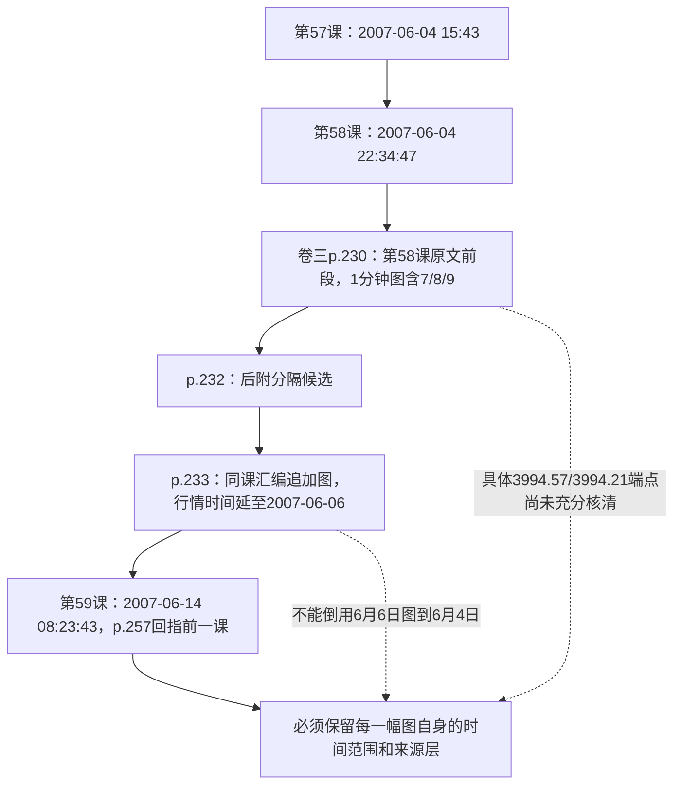
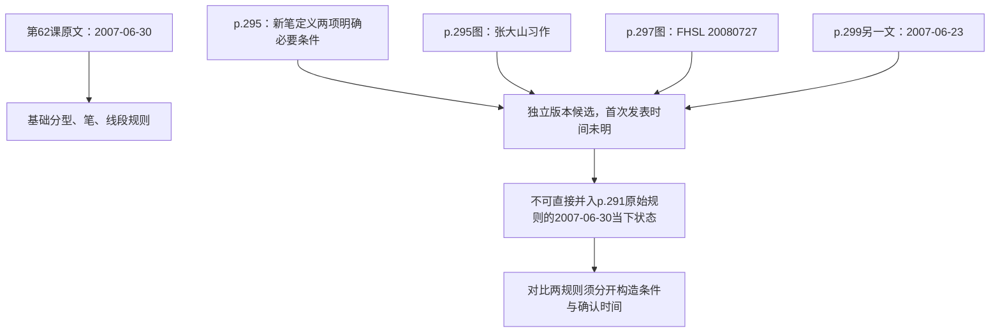

# 《缠论》原图追溯第二轮：7—8—9到底是哪幅图？“新笔”又是什么时候的规则？

> **目标不是再画一幅假想行情图，而是弄清原书哪幅图具有什么证据资格。** 本轮从SHA-256固定的[卷三原始PDF](../../../ChineseBooks/缠论/缠论_卷3.pdf)重新渲染、实看第57—59课和第62课补充材料的19页；另外查看[卷五p.399](../../../ChineseBooks/缠论/缠论_卷5.pdf#page=399)，共20个**新的重点物理页**。渲染及源哈希验证：[GitHub Actions运行 #42474970761](https://github.com/CrazyA1ice/TradeBooksInAIsEyes/actions/runs/42474970761)，图像仅在7天有效的`chanlun-source-figure-lineage-evidence`附件中，不在仓库复制PDF/JPG。前轮20页单独记录在[原图复核记录10](10_原书图像实页复核与后发资料辨析.md)。**两轮合计40个指定页的渲染，不等于40页每一个细小价位都已独立核准，更不等于五卷所有图已核。**

## 先给出本轮最有用的结论

**我们确实找到了带7、8、9编号的原图候选，且发现了不止一幅。现在还不能严谨地把3994.57和3994.21各自钉在某幅图的唯一像素端点上。** 因此正确的成果是**缩小候选范围、记录图与作者时间的关系、保留待核局部价位**，而不是编造一张“已完全复原”的7—8—9行情图。

| 要核的问题 | 原书实页发现 | 可下的结论 | **仍不能下的结论** |
|---|---|---|---|
| 第59课为何写7—8—9？ | [卷三p.257正文](../../../ChineseBooks/缠论/缠论_卷3.pdf#page=257)明确说“前面一课的7-8-9”，另提“8下来的低点3994.57”与“7中最后一个高点3994.21” | 这是一项**针对前课走势分段的文字比较**，两个极值确出自正文 | p.257不是7/8/9的截图；不能给两个数字随意分配图中坐标 |
| 前一课有没有7、8、9？ | [卷三p.230](../../../ChineseBooks/缠论/缠论_卷3.pdf#page=230)黑底**1分钟**走势中清楚标有7、8、9及后续10—16等编号，附成交量/MACD | 这是第58课*原文前段*的**强候选图页**，且实际能看到7/8/9编号 | 不能从肉眼相邻编号直接推导3994.57、3994.21就是所见第几根K线/哪条短线 |
| 是否还有另一版编号图？ | [卷三p.233](../../../ChineseBooks/缠论/缠论_卷3.pdf#page=233)为**上证指数1分钟**白底图，标出1—26（包括7/8/9），第7处附近有“3858”，末端时间到**2007-06-06** | **同课汇编中存在另一张编号体系相近而时间范围不同的图**；p.233的时间末端**晚于**第58课原文2007-06-04 22:34:47 | 不能把p.233的6月6日完成图当成作者6月4日发文时已完整看过的原图；也不能断定图中号码在两版里身份等价 |
| 第59课新三图是哪些？ | [卷三p.252—253](../../../ChineseBooks/缠论/缠论_卷3.pdf#page=252)行情图中可以看到20后至40多号的编号；前轮p.254—256继续这一序列 | 这些是第59课自带的延续分段图，不能误称为第58课唯一7—8—9原始图 | 图上所有微小价格/分段唯一性仍未核 |
| 什么价位可以完全确认？ | p.257原生正文精确出现**3994.57**与**3994.21** | 两个数字的**文字存在与相对比较对象**已核准 | **PENDING_PRICE_TO_PIXEL_MAPPING**：尚没有在本次指定图片里逐点独立核清两价对应的原图坐标 |

> 关键思考：原文写“7中最后一个高点”和“8下来低点”，**其语义是对走势片段内部局部高低点的比较**，并不是“给数字7的文字标签直接赋3994.21，给数字8直接赋3994.57”。即便某幅图确实标了7、8、9，也必须先认定**编号语法和图版本**，然后再校验哪段走势内部的高/低点。这个区分本身就是很容易漏掉的有用细节。

## 图像来源时间线：第58—59课的“当下”不能混用

**解释**：图p.230和图p.233都确有7/8/9编号；**“编号相同”并不证明“相同图片”、“相同信息截止点”、“相同K线坐标”**。p.233的标注时间从2007/05/29延续到2007/06/06（至少右端6月6日清晰可辨）；故它不能被用来重建作者6月4日发文时的完整已知行情。现阶段最可信的追溯层级是**p.257正文→第58课→p.230原文前段强候选；p.233后附替代候选**，具体两个小数极值在哪里仍为`PENDING_PRICE_TO_PIXEL_MAPPING`。

**AI独立启发**：交易理论里“同一个画图编号”也有**版本身份**，需要登记 `source_pdf_page`、`figure_time_end`、`original_posted_at`、`source_role`、`segment_label`、`numeric_claim_from_text`、`price_to_pixel_verified`。这只是未来可复核的元数据设计，**不是已发布或执行的行情解析器**。

## 第62课：把“新笔”条件、后附配图、作者署时拆开

本轮从同一卷原PDF**实页**观察[卷三p.294—299](../../../ChineseBooks/缠论/缠论_卷3.pdf#page=294)，结合之前p.292/293、p.300/301的核图：

| 位置 | 可核的正文或图上事实 | 应保留的来源身份 |
|---|---|---|
| p.291—294 | 第62课原文首个显示署时**2007-06-30 09:49:51**；p.294提到“图7”三相邻非包含K线分类、“图8”线段基本形态、“图9”线段破坏 | 作者首发内容范围的正文线索（但每幅图是否原作者亲绘需独立证据） |
| **p.295** | 上方有单独图示，图内署**“张大山习作”**；同页又起文字小标题“**新笔定义**”，开头以“本ID想了想…”叙述 | **图作者署名线索**与**新笔规则文字**分别记录，不能由图作者署名直接推出所有正文作者身份 |
| **p.295新笔第一条** | 包含处理后，顶底分型**不得共用K线** | 这是该补充文本声称与原规则相同的必要条件 |
| **p.295新笔第二条** | 顶分型最高K线与底分型最低K线之间，不含两端、**不考虑包含关系至少有3根K线** | 是该补充文本提出的放松规则；不能和第62课原始定义悄悄合并成同一个时间版本 |
| p.296 | 紧接着出现“上升K线/下降K线/包含处理”的文字解释，但该页**未给出能单独认定新笔规则首次发表日期的完整来源** | 补充说明，来源时点依旧 **UNKNOWN_SOURCE_DATE** |
| **p.297** | 彩色示意图顶端有“**FHSL 20080727**” | 图示标注日期明显晚于2007年6月首发；至多证明这幅图有**2008年后发图示线索**，并非原作者当日实时图 |
| p.298 | 另一张彩色示意图，属于同一汇编段的后附图表 | 仍需逐幅核对完整画者/发表身份 |
| **p.299** | 新出现另一标题和日期**2007-06-23 16:15:21**，竟**早于**第62课2007-06-30首发 | **PDF物理页顺序不是发表时间顺序**，不能按p.297→p.299推断规则逐日演化方向 |

**谨慎边界**：“本ID”作为文本中的第一人称，是**原PDF实际写出的语句**，但没有独立的网络发表原帖考证，不宜仅靠它判断作者、页面插入时间与所有配图画者均为同一人。可核的是**规则文字内容、图像署名及相对发表时间线索**，不是“整个新笔补充已确证由谁在何日首发”。

## 第108课再补一处：编排顺序不等于同一天只有一篇

本轮又读了[卷五p.399](../../../ChineseBooks/缠论/缠论_卷5.pdf#page=399)正文，显示另一段独立署时**2008-08-29 15:11:47**的**下午盘面评论**；而第108课开篇p.395署时**同日09:15:01**，p.398夹着一幅题为**“2007年10月—2008年10月分解图”**的图。由此能够确认：

- **8月29日上午原文**和**同日下午的评论**并非同一发帖时刻；
- 中间夹入**覆盖后续10月的图**，属于编排后的后验图像时间范围；
- 同一PDF的p.395→p.399**不是一个严格单调推进的当下时间序列**，不能使用p.398已经完整出现的后续行情评价上午文字的预测能力。

这条结论是**PDF中可定位的原文字日期与图标题对照**，不是从独立交易所行情推算出来的新增回测结果。[第108课规范研究](../../../analyses/books/chanlun/chapters/lesson_108.md)。

## 本轮逐项验收与真正剩余的检查

| 研究目标 | 实页进展 | 状态与后续 |
|---|---|---|
| 第59课回指第58课7—8—9 | **找到p.230和p.233两幅带编号原图**，区分正文/后附及作者发文时间 | **CANDIDATES_LOCATED／PRICE_TO_PIXEL_PENDING**，重点仍是3994.57/3994.21如何与特定内部高低点对应 |
| 第59课三图编号不能误配前课 | 看到p.252—253的20以后编号，与前轮p.254—256相互延续 | **VISUAL_PARTIAL_REVIEWED**，每幅图细小价仍有限 |
| 第62课新笔文字条件 | p.295两项明确条件独立复核，与图作者署名区分 | **TEXT_CONDITIONS_READ／PROVENANCE_LIMITED**，不是新旧两种笔完整形式证明 |
| 第62课后编时间非线性 | p.297有2008-07-27图，p.299有2007-06-23文 | **SOURCE_ORDER_NONCHRONOLOGICAL**，不能代替首次发表日期 |
| 第108课上午原文/下午评论/后来图 | p.395 09:15:01，p.399 15:11:47，p.398覆盖10月 | **AS_OF_CAUSALITY_BOUNDARY_CONFIRMED**，完整图像价位与原作者发帖身份继续限定 |
| 独立行情复原、盈利、背驰/买点概率 | 无真实行情实验 | **NOT_RUN** |

**终点仍然是“给读者讲清原作者实际如何推理”**：看原图是为了约束讲解，不是为了在仓库里制造20张重复截图。下一轮若继续深挖，优先对p.230和p.233的对应段做**更小区域的精确价位目视和原图版本对比**，只有两端点都能独立辨认时才把`PRICE_TO_PIXEL_PENDING`升格为`VERIFIED`。原书原图保留在唯一PDF，临时渲染可复现，研究命题始终`NOT_RUN`。
